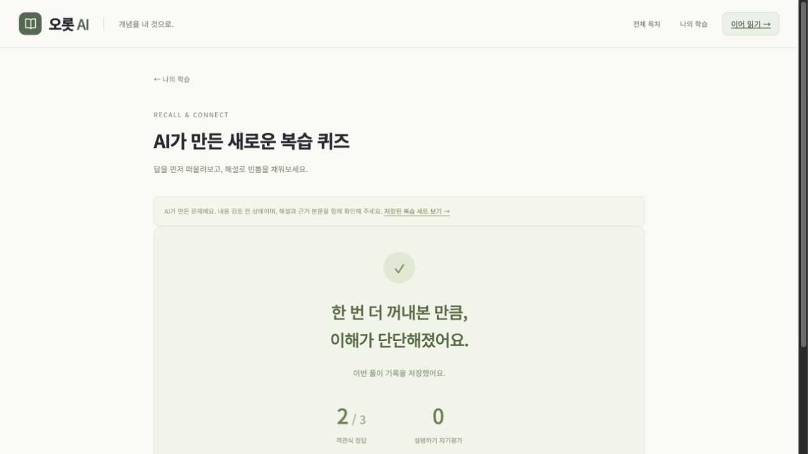

# 오롯 AI — 로컬 완성 및 운영 빌드 검증

읽기·퀴즈·노트·AI 복습·기록 백업을 사용할 수 있는 로컬 버전이다. AWS는 서울 t3.micro를 실습 때만 실행하고 매 부팅 120분 뒤 정지하는 구성으로 배포 중이다. 임시 HTTPS 주소를 사용하며 유료 도메인과 GPU는 생성하지 않는다. 로컬 Qwen 연결은 유지하고 AWS에서는 새 AI 생성을 비활성화한다. 실제 배포 결과와 운영 절차는 아래 문서를 따른다.

[6단계 실행·검증 안내](local-completion.md) · [전체 점검 결과](end-to-end-test-result.json)

[현재 AWS 배포 준비·견적](deploy/README.md) · [GitHub](https://github.com/CLM-BONNY/orot-ai)

## 운영용으로 실행하기

```sh
cd frontend
npm run build
cd ..
python3 run_local.py --production
```

기본 주소는 `http://127.0.0.1:5178/notebook`이다. 화면·콘텐츠·API 모두 이 주소에서 제공하고 Vite 개발 서버는 실행하지 않는다. 빌드 후 실행에는 Node.js가 필요하지 않다. 기존 Python 의존성과 모델 설정은 필요하다. 종료는 Ctrl+C다.

모델 없이 기본 학습 기능만 확인하려면 `python3 run_local.py --production --without-model`을 사용한다. 이 옵션은 모델을 시작하지 않으며, 이미 모델이 실행 중이면 AI가 연결될 수 있다. API 자체의 상태와 모델 준비 여부는 각각 `/api/health`, `/api/meta`에서 확인한다.

`나의 학습 → 학습 기록 백업·가져오기`에서 JSON 파일을 다운로드하거나 가져온다. 기록은 주소·포트·브라우저마다 다르므로 옮기기 전에 백업한다. 가져오기는 서버 업로드 없이 파일을 검증한 뒤 기존 기록을 유지하며 추가한다. 읽기·이어 읽기는 더 최근 기록을 사용하고 같은 ID에 다른 내용이 있으면 전체 취소한다. 입력 파일 제한은 20MB다.

## 현재 동작

- 8개 트랙·32개 챕터·96개 페이지를 기존 데이터에서 읽는다.
- 목차 이동, 챕터 내 페이지 탭, 이전·다음 페이지, Markdown·수식·코드 표시를 제공한다.
- `/curriculum`에서 전체 목차를 보고 개념·제목 검색과 트랙 필터를 사용할 수 있다.
- 읽기 완료·취소, 페이지·챕터·전체 진행률을 제공한다. 단순히 페이지를 열었다고 완료 처리하지 않는다.
- 마지막으로 펼친 페이지와 스크롤 위치를 IndexedDB(Dexie)에 저장한다. `/` 접속 또는 이어 읽기로 복원한다.
- 콘텐츠가 개정되면 이전 버전의 완료 기록을 보존하고 새 버전의 완료 여부와 구분한다. 개정된 본문은 맨 위부터 읽는다.
- 선행 챕터 링크, 현재 페이지의 개념 목록, 트랙별 참고 자료를 제공한다.
- `/notebook`의 나의 학습에서 챕터 퀴즈·오답노트·별표한 문제·개념 메모장·풀이 이력을 볼 수 있다.
- 객관식 64개는 선택 ID로 채점하고 당시 문제·선택지 순서·선택한 답·정오·시간을 저장한다. 원고의 A~D 해설에 맞게 화면의 보기 순서를 유지한다.
- 챕터 인출 연습 32개와 종합 서술형 6개는 내 설명을 쓴 뒤 기준 답안과 비교하고 자기평가를 저장한다. 객관식 정답 수와 합치지 않는다.
- 페이지·개념·문제에 메모를 남기고, 메모장에서 검색·수정하거나 관련 본문으로 돌아갈 수 있다.
- 한 번이라도 틀린 문제는 오답 이력에 남는다. 최근 풀이가 오답이면 다시 풀 대상이고, 재풀이로 맞히면 대상에서 빠지되 이전 오답 기록은 보존한다.
- 별표한 문제를 모아서 보거나 한 문제씩·전체를 다시 풀 수 있다. 별표와 풀이 이력은 당시 문제의 개정 버전과 스냅샷을 보존한다.
- 현재 페이지 또는 선택한 문장을 질문하면 실제 로컬 Qwen이 답한다. 답변의 참고 페이지를 링크로 보여주며 설명을 개념 메모장에 저장할 수 있다.
- 자료로 답하기 어려우면 `insufficient_context` 상태를 표시한다. 응답의 근거 ID를 서버에서 검증하며, 이 검사가 설명의 사실성을 입증하는 것은 아니다.
- 대화는 페이지별로 구분하며 현재 브라우저 실행 중 메모리에 유지한다.
- 중복 전송을 방지하고 모델 연결 실패·버전 불일치·과부하·시간 초과를 실제 오류로 표시한다.
- `/ai-review`에서 최대 5개 개념과 요청 난이도를 골라 복습 객관식 3개를 생성한다. 현재 페이지에서 바로 시작하거나 아직 틀린 문제의 개념을 가져올 수 있다.
- 생성 문제와 모델·프롬프트·콘텐츠 버전을 저장한다. 새로고침 후 세트를 다시 풀고 오답·별표·메모 기능을 사용할 수 있다.
- 요청 시간·입출력 토큰·모델 로딩 시간을 기록한다. 모델 연결·전체 시간 제한·결과 검증 실패를 실제 오류로 보여주며 기본 문제로 몰래 대체하지 않는다.



위 화면의 기록은 별도 `localhost:5179` 주소에서 기능 검증용으로 만든 기록이다. 사용자 주소 `127.0.0.1`의 학습 이력을 초기화하거나 테스트 풀이로 채우지 않았다. [실제 생성 예시](ai-review-example.json)는 자동 검사와 모델 검토를 통과한 실측 결과이며, 사람 검토 전의 예시다.

## 학습 흐름

1. 본문을 읽고 **챕터 퀴즈 풀기**를 누르거나, 나의 학습에서 챕터를 고른다.
2. 객관식 답을 선택하고 **정답 확인하고 저장**을 누르면 해설과 근거 페이지가 열린다.
3. 인출 문제는 내 설명 → 설명 기준 확인 → 자기평가 순서로 저장한다.
4. 나의 학습에서 오답을 다시 풀고, 문제의 별표를 등록·해제한다.
5. 본문·문제의 **개념 메모**를 열어 페이지·문제 또는 개념을 선택하고 저장한다. 개념 메모장에서 수정할 수 있다.
6. **AI 복습 퀴즈**에서 개념을 선택하고 새 3문제를 만든다. 만들어 둔 복습 세트에서 다시 풀 수 있다.
7. 공부 도우미 답변의 참고 페이지를 열거나 **이 설명을 메모로 남기기**를 누른다.

제출한 풀이는 매번 이력에 남는다. 퀴즈 화면을 새로고침하면 새 풀이를 시작하며 이미 제출한 답은 나의 학습의 풀이 이력에서 확인한다. 제출 전 선택·입력과 저장 버튼을 누르지 않은 메모 초안은 영구 저장하지 않는다.

## 읽기 기록의 저장 범위

기록은 현재 주소의 현재 브라우저 프로필에 저장한다. 새로고침과 브라우저 재실행 후에도 유지되지만, 브라우저 데이터를 지우거나 다른 브라우저·기기·배포 주소에서 열면 공유되지 않는다. 계정 동기화는 없고 JSON 백업·가져오기 UI로 주소를 옮긴다. 저장에 실패하면 오류를 표시하고 본문 열람은 계속 제공한다. AI 대화는 현재 실행 중 메모리에만 유지한다.

Dexie 버전 2에서 풀이·메모·별표·자기평가 테이블을, 버전 3에서 생성 실행·생성 문제 테이블을 추가한다. 이전 프로필과 읽기·메모·풀이 이력을 보존한다. 생성 문제 3개와 세트 정보를 한 트랜잭션으로 저장하며 재시도 시 같은 요청을 중복 저장하지 않는다. 메모·서술 응답은 Markdown으로 표시하되 임의 HTML을 실행하지 않는다. 삭제·가져오기·내보내기 UI는 이번 단계에 포함하지 않았다.

## AI 생성 결과의 검사와 한계

- Ollama JSON Schema 출력 제약과 Python 검증을 함께 사용한다.
- 3문항·각 4보기·정답 인덱스·빈 문자열·중복 질문·중복 보기·선택 개념·근거 페이지·개념 연결을 확인한다.
- 형식 검사 후 같은 로컬 모델에 별도 검토 프롬프트를 보내, 세 문제의 정답·해설·근거·주제 일치를 대조한다. 하나라도 확인하지 못하면 세트를 반환하거나 저장하지 않는다. 정상 생성은 모델 호출 두 번을 사용하며 전체 180초 제한을 공유한다.
- 서버가 문제 ID·선택지 ID·생성 ID·개정 해시를 부여한다. 브라우저도 해시를 확인한 뒤 저장한다.
- 관련 문단과 해당 개념에 집중한 페이지를 골라 전달한다. 개념 ID 기반 조회와 문단 선택이며 임베딩 검색은 아직 사용하지 않는다.
- 개인 메모·전체 풀이 이력을 모델로 보내지 않는다. 클라이언트가 추린 개념 ID와 페이지 ID만 보내고 서버가 학습자료를 조회한다.
- 구조 검사·근거 ID 검사·모델의 자동 검토도 정답의 정확성·유일성·교육 품질을 보증하지 않는다. 특히 생성자와 검토자가 같은 모델이라 오류가 함께 통과할 수 있다. 생성 결과는 사람 검토 전인 `unreviewed`로 저장하고 화면에 **AI 생성 · 내용 검토 전**을 표시한다.
- 같은 요청 ID와 같은 입력의 성공 결과는 서버 프로세스 안에서 최대 10분·16건까지 재사용한다. 재시작하면 이 캐시는 사라진다. 로컬 저장 실패 시 화면에 남은 생성 결과를 다시 저장해 모델 재호출을 피한다.
- 도우미와 생성기는 하나의 추론 슬롯을 공유한다. 실행 중 다른 요청은 429로 반환하고 자동 재시도를 하지 않는다.

현재 설정은 문맥 4,096토큰, 도우미 최대 768토큰 이상, 복습 최대 1,536토큰이다. `.env.local`의 `STRUCTURED_CONTEXT_LENGTH`·`REVIEW_MAX_OUTPUT_TOKENS`로 조정할 수 있다. 16GB 로컬 환경을 고려해 모델은 한 번에 하나만 로드하도록 실행한다. 정확한 메모리 사용량과 동시성 한계는 이후 성능 실험에서 측정한다.

## 확인한 로컬 모델

- 모델: `qwen3.5:9b-q4_K_M`
- 설정 메타데이터: 9.0B, GGUF, Q4_K_M
- 모델 파일 약 5.63 GB, 비전 projector 약 0.92 GB가 이미 존재한다. 현재 기능은 텍스트만 사용한다.
- 기존 모델 위치: `/Users/kimmandoo/Documents/Codex/2026-10-16/sk-x20/work/local-ai/models`
- 기존 실행 도구: 같은 폴더의 `../runtime/ollama` (확인한 버전 0.40.5)
- 이 작업에서는 모델을 다시 다운로드하거나 기존 모델 파일을 복사하지 않았다.

`.env.local`에 이 컴퓨터의 경로를 설정했다. 다른 위치로 옮기면 `.env.example`을 참고해 수정한다. 모델 가중치는 이 프로젝트 결과물에 포함되어 있지 않다.

## 실행

이 디렉터리에서 실행한다. `.python-version`은 확인한 로컬 Python 3.10.12 환경을 지정한다. 해당 Python에 FastAPI·uvicorn·httpx·Pydantic이 설치되어 있다.

```sh
python3 run_local.py
```

그다음 `http://127.0.0.1:5178/curriculum`을 열어 목차를 보거나 `http://127.0.0.1:5178/`에서 이어 읽는다. Ctrl+C로 종료하면 실행기가 자신이 시작한 프로세스만 종료한다. 이미 실행 중인 모델 서버는 재사용하고 종료하지 않는다.

퀴즈와 기록은 `http://127.0.0.1:5178/notebook`에서 확인한다. HTML 파일을 직접 여는 대신 이 개발 서버 주소로 접속한다.

코드를 수정하기 전부터 서버가 실행 중이었다면 종료 후 같은 명령으로 다시 실행해야 새 AI API가 반영된다. 별도 검증 서버는 `AI_STUDY_API_PORT=8019 AI_STUDY_FRONTEND_PORT=5179 python3 run_local.py`로 실행할 수 있다. 테스트 종료 시 검증 실행기가 시작한 프로세스만 정리했다.

새 Python 환경이면 가상환경에 의존성을 설치하고 실행한다. Node.js와 npm도 필요하다. 프런트 의존성은 `frontend/package-lock.json`으로 고정되어 있다.

```sh
python3 -m venv .venv
.venv/bin/python -m pip install -r backend/requirements.txt
cd frontend
npm ci
cd ..
.venv/bin/python run_local.py
```

## 실행 경로

```text
브라우저 :5178
  → Vite 개발 프록시
  → FastAPI :8018
    → Ollama :11535
      → Qwen3.5 9B (이미 내려받은 모델)
```

프런트는 `/content`와 `/api`만 호출한다. 서버가 `../data-design/data/`의 학습자료를 읽는다. 모델 주소는 브라우저가 아니라 서버 설정에서 관리한다. 현재 모든 서버는 loopback에만 바인딩하며 인터넷 공개용 설정이 아니다.

## 큰 모델로 바꾸는 방식

Python의 `InferenceProvider`가 모델 서버와의 통신을 담당한다. 현재는 Ollama API를 쓰고, 이후 GPU 배포에서는 vLLM 등의 OpenAI 호환 프로토콜을 사용할 수 있다. **OpenAI 호환은 통신 형식이며 OpenAI의 유료 API를 호출한다는 뜻이 아니다.**

```env
INFERENCE_PROVIDER=openai_compatible
INFERENCE_BASE_URL=http://private-gpu-server:8000/v1
MODEL_NAME=deployed-model-name
INFERENCE_TIMEOUT_SECONDS=180
```

위 주소·이름은 배포 설명용 예시다. 실제 GPU 서버와 모델을 만들었다는 뜻은 아니다. 변경한 뒤 백엔드를 재시작한다. 서버 인증이 필요하면 `INFERENCE_AUTH_TOKEN`을 서버 환경에서만 제공한다.

모델을 바꾸면 한국어 설명·근거 활용·정답 정확성·시간을 다시 평가해야 한다. 작은 모델의 연결 성공이 큰 모델의 품질·메모리·동시성 성능을 보장하지 않는다. GGUF 양자화 모델과 GPU용 다른 체크포인트의 실험 조건도 따로 기록한다.

## 로컬 테스트와 배포의 차이

현재 로컬 요청 마감 시간은 180초다. 모델 최초 로딩이나 노트북 추론을 위한 값이며 API Gateway HTTP API의 30초 제한에 그대로 들어가는 설계가 아니다.

현재 AWS 경로는 `임시 HTTPS → Caddy → Nginx/React → FastAPI`다. 서울 t3.micro·20GB gp3·고정 IPv4를 사용하고 웹도 실습할 때만 켠다. 매 부팅 120분 뒤 자동 정지하며 정지 중에는 접속할 수 없다. GPU와 모델 캐시 디스크는 생성하지 않았고 `INFERENCE_PROVIDER=disabled`이므로 새 AI 요청은 503으로 안내한다. 후속 추론 실험은 GPU 환경을 별도로 준비한 뒤 진행한다. [배포 결과·실행/정지·비용](deploy/README.md)을 따른다.

## 검증

```sh
python3 -m pytest backend/tests -q -p no:cacheprovider
cd frontend
npm test
npm run build
```

- 2단계에서 백엔드 10개 테스트 통과: 콘텐츠 연결, 버전·자료 검증, 클라이언트 역할 제한, 모델 실패, 동시 요청 제한, Ollama/호환 서버 어댑터, 전체 시간 제한. 4단계에서는 백엔드를 수정하지 않았다.
- TypeScript 검사와 Vite 프로덕션 빌드 통과.
- 현재 자동 테스트 총 102개 통과: 백엔드 61개 + 프런트 41개(읽기 10·퀴즈/메모 13·생성 세트 저장 10·백업 8). 운영 경로·캐시·누락 리소스·백업 복원/충돌 시 롤백을 포함한다.
- 백엔드는 개념·근거 검증, 형식·중복·범위 오류 거부, 잘린 결과 거부, 생성 후 내용 검토 실패 거부, 두 호출의 전체 시간 제한, 요청 재사용, 근거 부족 상태, 자체 호스팅 두 프로토콜의 구조화 출력을 검증했다.
- 프런트는 이전 DB의 기록 보존, 보기 ID 채점, 잘못된 선택지 거부, 중복 제출 방지, 스냅샷 보존, 오답 해소와 이력 유지, 개정 분리, 메모 수정·소유자 검사, 생성 세트의 원자적 저장·해시 검사·중복 방지·DB 재접속을 검증했다.
- 실제 HTTP로 챕터 퀴즈 파일 32개(객관식 64·인출 32)와 종합 문제 6개 조회 통과.
- 실제 브라우저에서 챕터 풀이·해설·메모 생성과 수정·별표 등록과 해제·오답 재풀이·자기평가·새로고침 후 기록 유지 확인. [4단계 검증 기록](practice-test-result.json)
- 5단계 실제 브라우저에서 Qwen 생성 → 자동 검사와 별도 모델 검토 → 저장 → 3문제 풀이 → 오답·별표 → 재풀이 → 새로고침 후 기록 유지 확인. 도우미의 근거 링크와 설명 메모 저장도 확인했다. [5단계 검증 기록](ai-test-result.json)
- 최종 설정의 복습 3문제 한 건은 약 48.8초(생성 33.1초 + 내용 검토 15.7초), 합계 입력 1,768·출력 925토큰이었다. 도우미 질문 한 건은 약 15.4초, 근거 부족 질문 한 건은 약 9.5초였다. 고정 조건 다회 측정이나 p95 기준선은 아니다.
- 구조 검사를 통과해도 근거 없는 용어를 섞는 사례가 있어 생성 후 검토를 추가했다. 실제 검토 거부 시 오류가 표시되고 저장 세트 수가 늘지 않는 것을 확인했다. 같은 모델의 자동 검토에는 한계가 있으므로 기본 문제와 생성 문제의 품질을 따로 평가해야 한다.
- 읽기 저장 테스트 10개 통과: 프로필 중복 생성 방지, 방문과 완료 구분, 중복 방문, 완료 유지·취소, DB 재접속, 콘텐츠 개정, 스크롤 복원 조건, 잘못된 입력과 소유자 검증.
- 96개 본문을 실제 로컬 HTTP로 조회해 ID·개정 버전·본문을 확인했다.
- 실제 브라우저에서 검색·트랙 필터·읽기 완료와 취소·새로고침 후 완료 유지·읽던 위치 복원·목차에서 이어 읽기를 확인했다.
- [3단계 검증 기록](reading-test-result.json)에 범위와 결과를 저장했다. 6단계에서 운영 빌드의 320px·390px 모바일 크기를 점검했다. 실제 휴대폰·Safari 검증과 AWS 배포 후 점검은 아직 수행하지 않았다.
- 브라우저에서 현재 페이지를 참고한 실제 Qwen 답변 확인.
- [실제 연결 테스트 기록](local-test-result.json)에 관측값을 저장한다. 단일 기능 점검 결과이며 부하 테스트나 p95 기준선이 아니다.

현재 번들은 수식 렌더러를 포함해 크기 경고가 있다. 클라이언트 전용 React Router의 `use client` 지시 관련 빌드 경고도 있었지만 빌드와 브라우저 동작은 통과했다. 코드 분리와 초기 로딩 최적화는 성능 측정 단계에서 다룬다.

## 참고 문서

- [Ollama Chat API](https://docs.ollama.com/api/chat)
- [vLLM 배포](https://docs.vllm.ai/en/latest/deployment/docker/)
- [서비스 아키텍처](../service-architecture.md)
- [데이터 설계](../data-design/README.md)
- [Dexie 데이터베이스 스키마](https://dexie.org/docs/Version/Version.stores())
- [Dexie 복합 인덱스](https://dexie.org/docs/Compound-Index)
- [Ollama 구조화 출력](https://docs.ollama.com/capabilities/structured-outputs)
- [vLLM 구조화 출력](https://docs.vllm.ai/en/stable/examples/features/structured_outputs/)

- [Vite 운영 빌드와 HTML 캐시 안내](https://vite.dev/guide/build.html)
