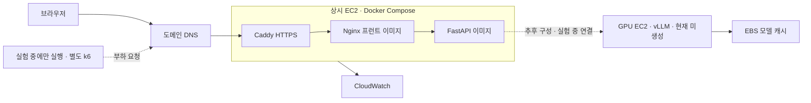

# Orot AI 배포 — 웹 상시, GPU는 실험할 때만

2026-10-25 갱신. 사용자 결정: 도메인·HTTPS·Docker·GitHub CI/CD를 갖춘 AWS 서비스에서 평가한다. 웹은 상시 운영하고 GPU는 실험할 때만 켠다. **현재 단계는 웹 배포이며 GPU EC2·GPU 캐시 EBS·부하 발생기는 생성하지 않는다.**

**현재 상태:** [GitHub 저장소](https://github.com/CLM-BONNY/orot-ai) 생성·push 완료. 2026-10-25 GitHub API에서 현재 공개 저장소임을 확인했다. [직전 코드 CI](https://github.com/CLM-BONNY/orot-ai/actions/runs/40168802244)(`520ee7379bca413ebe7e46dd6d45bf12dc4a7cd3`)에서 자동 테스트 128개(백엔드/배포 87·프런트 41), 인프라 lint, 실제 web/API Docker 빌드·HTTP 통합·인증·Caddy 설정 검증 통과. 사용자 승인 후 GitHub OIDC 공급자만 생성했다. EC2·유료 리소스·도메인·GPU는 아직 생성하거나 구매하지 않았다. [검증 기록](preparation-result.json) · [실제 AWS 실행 기록](aws-execution-result.json)

2026-10-25 사용자가 실제 배포를 요청했다. 웹 기본값을 `t3.small`로 바꾸고 정밀 측정용 `m7i.large`를 선택할 수 있도록 반영했다. T3에만 standard CPU 크레딧 설정을 적용한다. 콘솔 재로그인 후 기존 CloudShell로 읽기 전용 사전 조회를 완료했으며 로컬 AWS 자격 증명은 없다. `DEPLOY_ENABLED=false`를 유지하고 있다.

## 단계별 생성·실행 범위

| 단계 | 웹·API | GPU | 부하 발생기 |
|---|---|---|---|
| 현재 웹 배포 | `t3.small`·20GB gp3·고정 공인 IP·HTTPS·ECR·IAM·로그·CI/CD 준비 | EC2·모델 캐시 EBS 모두 미생성. GPU를 시작하는 작업 없음 | 미생성 |
| 추후 GPU 실험 준비 | 계속 운영 | 한도·모델·vLLM 확인 후 별도 구성. 다운로드·검증 중 실행 후 정지 | 필요 시 구성 |
| 실험 세션 | 필요 시 `m7i.large`로 측정 사양 고정 | 명시적으로 시작하고 종료 예약·실제 정지 확인 | k6 실행 중에만 사용 |
| 실험 종료 후 | 상시 운영 | stopped 유지. 보관한 EBS는 과금 | 정지·정리 여부와 잔여 디스크 비용 확인 |

웹 접속·챗봇 요청·웹 CI/CD가 GPU를 자동으로 켜지 않는다. GPU 미구성·정지 중 새 AI 답변/복습 문제 생성은 사용할 수 없고 글·기본 퀴즈·메모·저장된 복습은 유지한다. 웹 배포의 기본 `INFERENCE_PROVIDER=disabled`는 모델 서버에 접속하지 않고 AI 요청에 `503 MODEL_DISABLED`를 반환한다. 건강 상태와 기본 학습은 동작한다. 별도 GPU 전원 상태 연동 UI는 구현하지 않았다.

기본 `ec2/compose.yml`에는 추론 주소나 토큰 mount가 없다. 추후 AI를 명시적으로 활성화한 릴리스만 `compose.inference.yml`과 추론 Secret을 추가한다. 이 변경도 GPU 인스턴스를 시작시키지는 않는다. CloudFormation의 `InferenceSecretArn`은 웹 단독 배포에서 비워 두고 추론 비밀 읽기 권한도 부여하지 않는다.

사이트 로그인은 비용 승인 후 사용자가 CloudShell에서 `ec2/create_site_login.py`를 직접 실행해 초기 비밀번호를 비공개로 입력·확인한다. 기본 사용자명은 `orot`이며 Secrets Manager에는 salted SHA-512 crypt 형식의 htpasswd만 저장한다. 비밀번호를 채팅·명령 인자·로그에 넣지 않는다. 기존 로그인 Secret이 있으면 변경하지 않는다. 에이전트는 새 비밀번호 입력·확인·제출을 대신하지 않는다.

## 현재 배포 구성



- 기본 웹 서버: x86 `t3.small`(2GB). 빌드는 CI에서 수행하고 서버는 완성 이미지만 실행한다. T3 크레딧 모드는 standard로 두고 추가 Unlimited 크레딧 비용을 사용하지 않는다. 성능 실험에는 크레딧 상태도 기록한다. 정밀 측정 시 `m7i.large`(2 vCPU·8GB)를 선택할 수 있으며 개선 전후는 같은 유형으로 고정한다.
- 프런트·API·추론은 각각 이미지다. 초기 배포에서 프런트와 API는 같은 CPU EC2의 별도 컨테이너로 실행한다. 모델은 별도 GPU EC2에서 실행한다.
- Caddy가 도메인 HTTPS 인증서를 자동 발급·갱신한다. HTTP/HTTPS만 공개하고 SSH·API·모델 포트는 인터넷에 열지 않는다.
- GPU는 같은 VPC의 사설 주소로만 API 요청을 받는다. 다운로드와 관리에 사용하는 아웃바운드 통신은 별도로 필요하다. 첫 구성에서는 NAT Gateway·ALB·Fargate 비용을 추가하지 않는다.
- GPU가 꺼져 있어도 글·기본 퀴즈·메모·저장된 AI 세트는 사용할 수 있다. 새로운 AI 답변·문제 생성은 실제 연결 오류를 안내한다.
- 단일 CPU 서버의 Compose 교체 배포에는 짧은 중단이 생길 수 있다. 무중단·고가용성을 구현했다고 주장하지 않는다.
- 초기 사이트는 비밀번호로 보호한다. UI와 GPU 호출 API를 Nginx에서 함께 보호하고, 배포 확인용 health/release 경로만 인증 없이 읽을 수 있다.
- Nginx의 AI 경로는 IP별 분당 6건·burst 2 제한을 기본으로 둔다. 실험할 때 요청 제한과 애플리케이션의 1개 AI 동시 실행 제한을 기록한다.

`alternatives/ecs/`는 초기에 검토한 ECS+ALB 방식이다. 비용 선호에 따라 현재 배포 경로에서 제외했으며 활성 워크플로가 실행하지 않는다. 기존 S3·CloudFront/Lambda 설계도 최초 배포에는 쓰지 않는다. CDN·다중 서버는 이후 비교 실험으로 추가할 수 있다.

## 비용 견적

[계산식과 AWS 공식 원본 요금](cost-estimate.json). 서울 리전 Linux On-Demand, 2026-10-25 공식 가격 피드 재확인. 리전은 실제 배포 전에 계정의 가용 용량·GPU 할당량과 함께 확인한다.

| 항목 | 견적 |
|---|---:|
| 웹 `t3.small` 730시간 | $18.98/월 |
| 웹 gp3 20GB | $1.82/월 |
| 웹 공인 IPv4 730시간 | $3.65/월 |
| 현재 웹 서버·디스크·공인 IP 소계 | **$24.45/월** |
| 추후 GPU 캐시용 gp3 100GB 유지 | 생성 후 $9.12/월 |
| 추후 GPU 후보 `g5.xlarge` | 실행할 때 $1.237/시간 |
| 추후 GPU 실행 중 공인 IPv4 | $0.005/시간 |

현재 GPU 관련 리소스를 생성하지 않으면 GPU 실행·캐시 디스크 비용은 $0이다. **GPU를 구성한 이후의 참고 시나리오**는 100GB 캐시 디스크 유지·GPU 실행 월 0시간 $33.57, 10시간 $45.99, 20시간 $58.41이다. 월 10시간은 견적 예시이며 예약 실행·최소 사용량·상시 실행 계획이 아니다. 정밀 측정용 `m7i.large` CPU 실행 요금은 시간당 $0.1239이며 부하 발생기와 함께 별도 사용량을 계산한다. 도메인 등록/갱신·DNS·Secrets Manager·ECR·CloudWatch·트래픽·세금·환율·무료 크레딧은 미반영이다. 청구 총액이나 확정 예산 상한이 아니다. GPU 캐시를 보관하면 GPU를 꺼도 디스크 비용이 남는다. 모델에 필요한 GPU/디스크 크기에 따라 견적이 달라진다.

도메인 후보는 `orot-ai.dev`다. 2026-10-25 Route 53 Domains API 재조회에서 등록 가능하며 등록·갱신 각각 연 $17이었다. 처음 검토한 `.study`는 Route 53 등록 미지원, `orot-ai.com`은 2026-10-19 조회에서 등록 불가였다. 구매 직전 가격·가용 여부를 다시 확인하며 아직 구매하지 않았다. 도메인 구매는 기술적 필수 조건은 아니지만 이번 완료 기준에는 포함한다. 실제 구매·유료 리소스 생성 전 예상 비용과 사용 상한을 확정한다.

2026-10-25 사용자가 연 단위 도메인 결제와 포트폴리오 필요성을 질문했다. 도메인 구매 없이 임시 HTTPS 주소로 인프라 실험을 진행할 수 있다고 안내했고 최종 선택·웹 비용 승인은 대기 중이다. 대안은 공인 IP를 포함하는 `orot.<공인IP>.sslip.io` 형식의 호스트명과 Caddy 자동 HTTPS다. 구매비·Route 53 호스팅 존은 필요하지 않지만 외부 DNS 가용성·인증서 발급 조건에 의존하며 실제 DNS/TLS 검증은 배포 단계에서 수행한다. [DNS 서비스 공식 설명](https://nip.io/) · [Caddy 자동 HTTPS](https://caddyserver.com/docs/automatic-https)

이전에 제안한 월 $50·GPU 월 10시간·도메인 1년 $17은 승인되지 않은 견적 제안이다. 현재 웹만 배포하는 비용과 추후 GPU 세션 비용을 분리해 확정한다. 월 누적 GPU 시간 자동 차단은 아직 구현하지 않았다. 예산 알림도 결제 차단 기능이 아니다.

## 실제 AWS 계정 사전 점검

[이전 점검 기록](account-preflight.json), 2026-10-19. [최신 점검 기록](account-preflight-2026-10-25.json), 2026-10-25. 사용자 로그인 후 기존 AWS CloudShell 세션으로 조회했으며 자격 증명을 로컬로 내보내지 않았다.

- 서울 리전 `ap-northeast-2` 접속 확인. 이 리전 EC2 0개·Elastic IP 0개.
- 일반 On-Demand vCPU 한도 5: 제안한 웹 서버 1대에 충분하다.
- G/VT On-Demand vCPU 한도 **0**: GPU 생성 전 증액이 필요하며 기존 증액 요청은 없었다. `g5.xlarge` 또는 `g4dn.xlarge` 한 대 후보에 필요한 4 vCPU를 요청할 계획이다. 아직 제출하지 않았다.
- 두 GPU 유형은 서울 리전 제공 목록에 있지만 즉시 가용 용량·모델 적합성은 검증하지 않았다.
- IAM OIDC provider가 없어 GitHub 배포용 provider와 main 전용 Role 생성이 필요하다. 실제 생성 권한·배포 성공은 아직 검증하지 않았다.
- 현재 콘솔은 root 세션이다. 기존 로그인으로 사전 조회만 했고 새 장기 액세스 키를 만들지 않았다.
- GPU 증액 대기 중에도 웹·기본 학습 기능의 배포를 먼저 진행할 수 있다. AI 배포 완료 판정은 실제 GPU 호출 후에 한다.
- 2026-10-25 재조회에서 EC2·ECR·OIDC provider·orot 프로젝트 스택이 모두 없었고 GPU 한도 0, `orot-ai.dev` 등록 가능·등록/갱신 각 $17을 재확인했다. 일반 CPU 한도·Elastic IP 수·GPU 유형 제공 여부는 2026-10-19 조회값이며 이번 재조회 항목에는 포함하지 않았다.

## Git과 이미지

- GitHub: 소스·Dockerfile·Compose·CI/CD·인프라·평가 코드
- ECR: `orot-ai-web`, `orot-ai-api`, `orot-ai-inference`
- 이미지 태그: Git SHA + Actions 실행 ID + 재실행 번호. 배포는 불변 `repository@sha256:...` 사용
- 베이스 Python·Node·Nginx·Caddy 이미지와 공식 Action은 확인한 digest/commit으로 고정
- 모델 가중치는 Git/앱 이미지에 넣지 않고 GPU EBS에 다운로드한다. 모델 저장소·체크포인트 commit·vLLM 이미지 digest는 모델/GPU 선택 후 고정한다.
- `.env.local`, `.env.docker`, 가중치·개인키·캐시는 Git과 Docker 빌드 컨텍스트에서 제외한다.

## 로컬 Docker와 CI

저장소 루트에서 다음 명령으로 웹/API 컨테이너를 실행한다. 기본 주소는 `http://127.0.0.1:5180`이다.

```sh
docker compose -f ai-study-site/deploy/compose.yml up --build --wait
python3 ai-study-site/deploy/scripts/container_smoke.py
```

이 Mac에는 Docker가 없어 실제 컨테이너 검증은 GitHub Actions Linux runner에서 수행한다. 기본 Compose는 모델을 다운로드·시작하지 않는다. 별도로 실행한 Mac Ollama를 `host.docker.internal:11535`로 연결하도록 되어 있으나 Docker Desktop 호스트 접근 설정과 실제 모델 연결은 별도 확인해야 한다.

CI는 Python/프런트 테스트·빌드, CloudFormation lint, 실제 Docker 빌드·기동, 전체 콘텐츠/문제/직접 경로/오류의 프록시 통합, Caddy 설정, 사이트 비밀번호 보호를 검사한다. 인증 테스트는 폐기 가능한 고정 fixture만 사용한다. GPU는 CI에서 실행하지 않으며 CI 성공을 AI 품질·GPU 성능 검증으로 해석하지 않는다.

## 웹 CI/CD

`.github/workflows/deploy.yml`은 실제 인프라 준비 후 `DEPLOY_ENABLED=true`로 활성화한다. 현재는 비활성 상태다.

1. main push의 CI 성공 → 정확한 Git SHA checkout. PR·다른 저장소 이벤트는 배포하지 않는다.
2. 테스트·CPU 컨테이너 통합 점검 후 GitHub OIDC로 제한된 AWS Role을 사용한다.
3. 테스트한 이미지를 ECR에 push하고 digest를 읽는다.
4. SSM Run Command로 CPU EC2에 릴리스 파일을 전달한다. SSH 키와 GitHub 토큰을 EC2에 전달하지 않는다.
5. EC2가 instance role로 ECR 이미지를 pull하고 Secrets Manager에서 비밀을 읽는다. GitHub/SSM 명령 본문에 비밀 값을 넣지 않는다.
6. Compose 교체 후 로컬 health/release와 공개 HTTPS의 Git SHA 일치를 확인한다. 실패하면 이전 릴리스로 되돌린다. 첫 배포는 이전 버전이 없어 롤백할 수 없다.
7. 성공 릴리스의 Git SHA·이미지 digest·결과를 Actions artifact로 남긴다.

비밀은 EC2의 root 전용 릴리스 디렉터리에 파일로 보관하고 해당 컨테이너에만 읽기 전용으로 mount한다. 파일의 컨테이너 읽기 권한과 호스트 상위 디렉터리 권한을 구분한다. 이전 릴리스의 비밀 파일을 보존해 코드 롤백 때 함께 사용한다. 디스크 암호화와 instance role의 최소 권한을 사용한다.

필요한 GitHub 변수:

| 변수 | 용도 |
|---|---|
| `DEPLOY_ENABLED` | 인프라 준비 전 `false` |
| `AWS_REGION` | 실제 리전 |
| `AWS_DEPLOY_ROLE_ARN` | 이 저장소 main만 신뢰하는 OIDC Role |
| `APP_INSTANCE_ID` | CPU EC2 |
| `APP_DOMAIN` | 등록·연결한 도메인, scheme 없이 입력 |
| `INFERENCE_PROVIDER` | 웹 단독 배포 기본 `disabled`; 추후 활성화 시 `openai_compatible` |
| `INFERENCE_BASE_URL` | AI 활성화 릴리스에서만 GPU 사설 IP의 `http://주소:8000/v1` 필요 |
| `MODEL_NAME` | AI 활성화 릴리스에서만 served model name 필요 |
| `INFERENCE_SECRET_ARN` | AI 활성화 릴리스에서만 모델 인증 토큰 Secret ARN 필요 |
| `SITE_LOGIN_SECRET_ARN` | htpasswd 로그인 Secret ARN |

현재 이 Mac에 AWS CLI/자격 증명이 설정돼 있지 않다. 기존 콘솔의 CloudShell로 계정 사전 조회는 완료했고, 실제 리소스와 OIDC 신뢰 claim은 생성·배포 단계에서 확인해야 한다. OIDC 템플릿은 저장소/소유자 ID 및 main branch를 제한한다. 계정 전체 관리자 권한을 GitHub에 주지 않는다.

## GPU 실험 운영

- `inference.yml`은 검증한 공식 vLLM base digest를 받아 추론 이미지를 빌드·ECR에 게시하는 수동 워크플로다. 실제 GPU 배포·체크포인트 설정은 아직 미완료다.
- `compose.gpu.yml`은 Linux·NVIDIA Container Toolkit용 예시다. 기본 포트는 loopback에만 열려 있다. 실제 배포 시 GPU 사설 IP로 bind하고 SG는 CPU 서버와 별도로 허용한 내부 부하 발생기에서만 허용한다.
- GPU 인스턴스와 모델을 준비한 뒤 실험 시작 시 `ec2/gpu_session.py start --instance-id ... --minutes 60`으로 제한된 세션을 시작한다. 현재 스크립트의 기본 시간은 60분이며 지원 범위는 15~180분이다. 지정 태그·shutdown=stop을 확인하고 종료 예약 실패 시 인스턴스를 정지한다. 실험이 끝나면 명시적으로 정지하고 AWS 상태가 실제 stopped인지 확인한다. 모델 다운로드·기동·검증도 실제 실행 요금에 포함한다.
- 해당 스크립트는 GPU/SSM의 실제 환경 검증을 아직 하지 않았다. 단위 테스트는 다른 인스턴스 오작동 방지·세션 범위·종료 예약 실패 시 정지를 확인한다. AWS Budget 알림도 청구 차단 장치가 아니다.
- 모델/인스턴스 생성·다운로드·준비 상태·시작/정지·종료 예약을 실제 검증한 후 사용한다. 로컬 GGUF 모델과 GPU 체크포인트 결과는 따로 기록한다.

## 인프라 파일과 남은 순서

| 파일 | 준비한 내용 | 아직 필요한 것 |
|---|---|---|
| `cloudformation/registry.yml` | 불변 ECR 3개 | AWS 연결 후 생성 |
| `cloudformation/web-ec2.yml` | VPC·서브넷·CPU EC2·고정 IP·SG·SSM role·로그·선택 DNS | 계정/비밀/도메인 준비, 실제 생성·bootstrap 확인 |
| `cloudformation/github-oidc.yml` | ECR push·지정 EC2 배포만 허용하는 main 전용 Role | 계정의 OIDC provider 확인 |
| `ec2/compose.yml`, `Caddyfile` | CPU 서비스·HTTPS·로그·접근 제한 | 실제 서버에서 검증 |
| GPU | Docker 실행 정의·세션 제어 준비 | 모델/GPU 선택·인프라·다운로드·실제 기동 검증 |

다음 순서로 진행한다.

1. 현재 웹 배포의 비용·도메인 등록과 IAM 범위를 확정한다. 콘솔 로그인·읽기 전용 조회는 완료했고 키를 채팅이나 Git에 붙여 넣지 않는다.
2. 도메인 가능 여부·등록/갱신 가격을 확인하고 구매·DNS를 설정한다.
3. ECR·웹 EC2·비밀·OIDC를 생성하고 SSM/bootstrap 상태를 검증한다.
4. GPU 미구성 상태로 웹 최초 배포, 기본 학습 기능·AI 연결 오류 안내·TLS·재시작·롤백을 검증한다. 웹 CI/CD를 활성화하고 코드 버전을 기록한다.
5. 추후 AI 실험을 준비할 때 모델·GPU·할당량·라이선스·vLLM 호환성과 세션 시간·비용을 확정하고 GPU를 별도 구성한다. 실제 AI 호출·종료 예약·정지 상태를 검증한다.
6. 고정 환경에서 ④ 지연·비용, ⑤ 부하·장애 복구를 우선 평가한다. 실제 추론 실험 중에만 GPU를 켠다. ①~③ AI 품질·⑥ 보안/회귀의 확장 평가는 후속 계획으로 관리한다.

사이트 주소가 바뀌면 IndexedDB가 자동 이동하지 않는다. 기존 주소에서 JSON 백업 후 새 도메인에서 가져온다.

## 공식 근거

- [EC2 가격](https://aws.amazon.com/ec2/pricing/on-demand/) · [서울 EC2 공식 요금 데이터](https://pricing.us-east-1.amazonaws.com/offers/v1.0/aws/AmazonEC2/current/ap-northeast-2/index.json)
- [EC2 정지·시작과 디스크 보존](https://docs.aws.amazon.com/AWSEC2/latest/UserGuide/Stop_Start.html)
- [SSM Run Command](https://docs.aws.amazon.com/systems-manager/latest/userguide/run-command.html)
- [Caddy 자동 HTTPS](https://caddyserver.com/docs/automatic-https)
- [ECR](https://docs.aws.amazon.com/AmazonECR/latest/userguide/what-is-ecr.html)
- [GitHub AWS OIDC](https://docs.github.com/en/actions/how-tos/secure-your-work/security-harden-deployments/oidc-in-aws)
- [vLLM Docker](https://docs.vllm.ai/en/stable/deployment/docker/)
