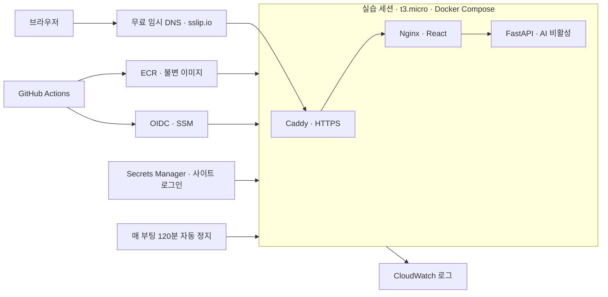

# Orot AI 실습용 AWS 배포

**추가 요청:** 웹 배포 후 사용자가 GPU·모델 다운로드·실제 AI 연결도 요청하고 웹·GPU 합산 월 $25 운영예산(세금 별도)을 승인했다. [GPU 배포 진행·비용·남은 승인](gpu-deployment.md)을 따른다. GPU 한도 0→4 vCPU 증액 요청은 접수됐지만 실제 적용값은 0이다. GPU 서버와 모델 연결은 아직 완료하지 않았다.

다음은 완료된 **첫 웹 단독 배포**의 기록이다. 서울 t3.micro를 실습할 때만 실행하고 도메인을 구매하지 않았다. 당시 승인 예산은 월 $10이었으며, 현재 합산 운영예산은 위의 월 $25로 변경됐다. 월 예산은 자동 결제 차단 상한이 아니다.

주소는 **https://orot.13.124.182.186.sslip.io**다. 서버 정지 중에는 접속되지 않는다. 로그인 아이디는 `orot`, 비밀번호는 사용자가 CloudShell에서 직접 설정한 값이다. 에이전트는 비밀번호를 알지 못하며 Git·명령 인자·로그에 남기지 않았다.

**현재 상태: 웹 배포 완료.** [CI](https://github.com/CLM-BONNY/orot-ai/actions/runs/40172094509)에서 135개 자동 테스트(백엔드/배포 94·프런트 41), 실제 Docker HTTP·인증·인프라 lint 검사를 통과했다. [실제 AWS 배포](https://github.com/CLM-BONNY/orot-ai/actions/runs/40172193910)는 ECR → OIDC/SSM → 공개 HTTPS 버전 확인까지 성공했다. 실제 버전 불일치 배포의 자동 복구, 서버 종료 서비스의 stopped 상태, 재시작 후 앱·인증서·타이머 복원도 확인했다. 사용자가 외부 브라우저의 로그인 성공과 사이트 표시를 확인했다. [실제 AWS 결과](aws-execution-result.json) · [코드/CI 검증](preparation-result.json)

현재 배포 버전은 `13d7cdc99b41edd57ea94c0d2647ccf075bbccdf`다. 문서 기록 커밋은 `[skip ci]`로 저장하므로 이 배포 SHA와 저장소의 최종 문서 SHA가 다를 수 있다. 사용자 확인을 위해 서버를 켜 두었으며 **2026-10-25 18:25:17 KST 자동 정지 예정**이다. 이후 상태는 콘솔에서 확인한다.

## 구성과 생성 범위



| 항목 | 실제 구성 |
|---|---|
| 리전 | `ap-northeast-2` 서울 |
| 웹·API | `t3.micro` 2 vCPU·1GiB, CPU 크레딧 standard |
| 인스턴스 | `i-0c40b75c4fb81e590`, Name `orot-ai-web` |
| 디스크·주소 | 암호화 gp3 20GB, 고정 IPv4 `13.124.182.186` |
| 컨테이너 | Caddy·Nginx·FastAPI, 빌드는 GitHub runner에서 수행 |
| 생성 스택 | `orot-ai-registry`, `orot-ai-web`, `orot-ai-github` |
| 이미지 | ECR `orot-ai-web`, `orot-ai-api`; 추론 저장소는 비어 있음 |
| 관리·배포 | SSH 없이 SSM, 장기 AWS 키 없이 GitHub OIDC |
| 공개 포트 | HTTP 80, HTTPS 443 TCP/UDP. API·모델·SSH 포트 비공개 |
| 관측 | `/orot-ai/application` CloudWatch 로그, 보존 14일 |
| 생성하지 않은 것 | 유료 도메인·Route 53 hosted zone·GPU EC2/디스크·부하 발생기·NAT Gateway·ALB |

Caddy가 임시 호스트명의 인증서를 발급·갱신한다. 인증서 볼륨은 컨테이너 교체와 EC2 정지/시작 후에도 보존한다. `sslip.io` DNS는 외부 서비스에 의존한다. EIP를 바꾸면 주소와 브라우저의 학습 기록 저장 위치도 바뀐다. [DNS 설명](https://nip.io/) · [Caddy 자동 HTTPS](https://caddyserver.com/docs/automatic-https)

초기 사이트는 Nginx HTTP Basic 인증으로 보호하고 health/release 경로만 공개한다. 로그인 비밀은 사용자가 직접 입력·확인했으며 Secrets Manager에는 salted SHA-512 crypt htpasswd를 저장한다. 호스트 root 전용 릴리스 폴더의 파일로 읽어 해당 컨테이너에만 읽기 전용 mount한다.

## 실습 시작과 종료

1. [서울 EC2 콘솔](https://ap-northeast-2.console.aws.amazon.com/ec2/home?region=ap-northeast-2#Instances:instanceId=i-0c40b75c4fb81e590)에서 위 인스턴스만 선택해 **인스턴스 시작**을 누른다.
2. 상태 검사와 SSM 연결이 준비되고 컨테이너가 뜨면 사이트 주소를 연다. 도메인과 로그인은 그대로 사용한다.
3. 실습이 끝나면 **인스턴스 중지**를 누르고 `stopped`를 확인한다. `종료(terminate)`는 디스크를 제거하므로 사용하지 않는다.
4. 수동 중지를 잊으면 매 부팅 120분 후 `orot-lab-stop.timer`가 `shutdown -h now`를 실행해 인스턴스를 정지한다. 이 타이머는 월 누적 시간이나 청구액을 차단하지 않는다.

CloudShell에서 사용할 명령도 다음과 같다. 새 장기 키를 만들 필요가 없다.

```sh
aws ec2 start-instances --region ap-northeast-2 --instance-ids i-0c40b75c4fb81e590
aws ec2 describe-instances --region ap-northeast-2 --instance-ids i-0c40b75c4fb81e590 --query 'Reservations[0].Instances[0].State.Name' --output text
aws ec2 stop-instances --region ap-northeast-2 --instance-ids i-0c40b75c4fb81e590
```

EC2 정지 중 EBS·고정 IP·비밀·이미지 보관료는 남는다. 월 40시간은 계산 예시다. 자동 정지를 비용 측정 실험에서 변경해야 한다면 실행 시간과 요금을 먼저 다시 정한다.

## 비용

[계산식·공식 가격 데이터](cost-estimate.json). 2026-10-25 서울 Linux On-Demand 확인값이다. 무료 크레딧·프로모션은 차감하지 않았다.

| 항목 | 월 예시 |
|---|---:|
| t3.micro 40시간 × $0.013 | $0.52 |
| gp3 20GB × $0.0912 | $1.824 |
| 고정 IPv4 보관 730시간 × $0.005 | $3.65 |
| 서버·디스크·IP 소계 | **$5.994 ≈ $5.99** |
| 승인된 운영예산 | **$10, 세금 별도** |

월 내내 서버를 정지해도 디스크·IP 기본 소계는 약 $5.47다. Secrets Manager·ECR·CloudWatch 로그·트래픽·세금은 별도이므로 $5.99가 총 청구액은 아니다. 현재 GPU·모델 디스크와 유료 도메인 요금은 없다. t3.micro 상시 실행 비교값은 월 $14.96이며 선택하지 않았다. 정밀 측정용 `m7i.large`나 별도 부하 발생기는 현재 배포에 추가하지 않았다.

AWS Budgets 알림이나 강제 청구 차단은 만들지 않았다. 현재 비용 보호 장치는 실습 후 수동 중지, 부팅 후 120분 자동 정지, CPU 크레딧 standard 모드다.

## CI/CD와 권한

`.github/workflows/deploy.yml`은 `DEPLOY_ENABLED=true`로 연결했다. **배포할 때 EC2가 실행 중이고 SSM Online이어야 한다.** 워크플로는 인스턴스를 시작할 권한이 없으므로 정지 중 배포는 실패한다. 일반 push는 main CI 성공 후 배포하며, 수동 실행은 main에서만 허용한다. 문서만 바꾼 `[skip ci]` 커밋은 배포하지 않는다.

1. 고정 Git SHA를 checkout하고 Python·프런트·실제 Docker HTTP 검사를 통과한다.
2. main만 신뢰하는 OIDC 역할로 ECR에 이미지를 게시한다. 태그는 SHA/실행 ID/재실행 번호, 실행은 `repository@sha256:...`로 고정한다.
3. SSM으로 지정 웹 EC2에만 릴리스를 전달한다. SSH 키·GitHub 토큰·장기 AWS 키를 EC2에 넣지 않는다.
4. 호스트 instance role로 ECR과 지정 사이트 Secret만 읽는다. GitHub 역할은 Secret을 읽지 않는다.
5. Docker Compose 교체 후 내부 health/release와 공개 HTTPS의 Git SHA를 확인한다. 실패하면 이전 릴리스로 복구한다. 첫 릴리스는 이전 버전이 없어 롤백할 수 없다.
6. Actions artifact로 릴리스 SHA·이미지 digest·공개 URL을 남긴다. 호스트 `/opt/orot/current`, `/opt/orot/previous`로 릴리스를 추적한다.

내장 브라우저는 Basic 인증창을 표시하지 못해 `ERR_INVALID_AUTH_CREDENTIALS`가 발생할 수 있다. Chrome·Safari 등 외부 브라우저에서 접속하며 사용자가 로그인 성공을 확인했다. 인증을 해제하거나 비밀번호를 URL에 넣지 않는다.

사이트 인증과 AI 요청 제한을 유지한다. 단일 EC2의 Compose 교체는 짧은 중단이 있을 수 있다. 무중단·고가용성 구성은 아니다. 공식 Actions·Python/Node/Nginx/Caddy 베이스는 commit/digest로 고정한다.

| GitHub 변수 | 값/역할 |
|---|---|
| `DEPLOY_ENABLED` | `true` |
| `AWS_REGION` | `ap-northeast-2` |
| `AWS_DEPLOY_ROLE_ARN` | 지정 main·ECR·웹 EC2 SSM만 허용하는 역할 |
| `APP_INSTANCE_ID` | `i-0c40b75c4fb81e590` |
| `APP_DOMAIN` | `orot.13.124.182.186.sslip.io` |
| `SITE_LOGIN_SECRET_ARN` | 사용자 설정 htpasswd Secret ARN |
| `INFERENCE_PROVIDER` | `disabled` |
| `INFERENCE_BASE_URL`, `MODEL_NAME`, `INFERENCE_SECRET_ARN` | 현재 불필요. AI 활성화 시에만 설정 |

## AI 기능과 후속 실험

기본 `ec2/compose.yml`에는 추론 주소·토큰·mount가 없다. `INFERENCE_PROVIDER=disabled`는 네트워크로 모델에 접속하지 않고 `503 MODEL_DISABLED`를 반환한다. 글·기본 퀴즈·메모·저장된 복습은 웹이 켜져 있으면 동작한다. 웹 접속이나 CI/CD가 GPU를 켜지 않는다.

GPU는 추후 모델·라이선스·런타임·한도·비용을 확정한 뒤 별도로 구성한다. 2026-10-25 사전 점검의 G/VT 한도는 0 vCPU였다. vLLM 이미지·모델은 아직 AWS에서 검증하지 않았다. 활성화 릴리스에만 `compose.inference.yml`과 사설 추론 주소·Secret을 추가한다. `gpu_session.py`는 준비된 코드이며 실제 GPU 시작/정지 검증을 했다는 뜻은 아니다.

다음 실험은 웹/API의 ④ 지연·비용, ⑤ 부하·장애 복구다. 먼저 코드·콘텐츠·사양·T3 크레딧·자동 정지 조건을 고정하고 기준선을 측정한다. 실제 AI가 없는 결과를 AI 추론 성능이라고 기록하지 않는다. 추후 AI 품질·검색/문맥·보안 회귀 평가와 추론 서버 부하를 별도로 추가한다.

학습 기록은 브라우저별 IndexedDB다. `127.0.0.1`의 기록은 새 HTTPS 주소로 자동 이전되지 않는다. 기존 화면의 JSON 백업을 새 주소에서 가져온다.

## 검증 근거와 한계

[실제 AWS 결과](aws-execution-result.json)를 최종 기준으로 확인한다. [코드 검증](preparation-result.json)에는 테스트·컨테이너·인증·인프라 lint 결과를 기록한다. [10월 19일](account-preflight.json)·[10월 25일 배포 전](account-preflight-2026-10-25.json) 계정 점검은 생성 전 시점의 스냅샷이다.

CI는 모델 품질·GPU 성능을 검증하지 않는다. 본 배포는 성능 기준선 측정과 별개다. 호스트의 버전 불일치 실패 후 자동 복구를 검증했다. 외부 HTTPS 단계에서만 발생하는 실패를 별도로 유도하지는 않았다. 종료 서비스는 20초짜리 임시 타이머로 호출해 실제 정지를 확인했고, 영구 120분 타이머를 끝까지 기다린 검사는 아니다. 재시작 후 120분 예약이 다시 잡히는 것을 확인했다. 모바일 Safari·실제 휴대폰 검증은 아직 수행하지 않았다.

## 파일과 로컬 실행

- `cloudformation/registry.yml`: ECR 3개
- `cloudformation/web-ec2.yml`: 네트워크·CPU EC2·EIP·SSM role·로그·자동 정지
- `cloudformation/github-oidc.yml`: 지정 저장소 main만 신뢰하는 ECR/SSM 배포 역할
- `ec2/compose.yml`, `Caddyfile`, `apply_release.py`, `deploy.py`: 웹 릴리스·HTTPS·검증·롤백
- `ec2/create_site_login.py`: 사용자가 직접 비밀번호를 입력하는 초기 설정. 기존 Secret은 변경하지 않음
- `alternatives/ecs/`: 첫 배포에서 사용하지 않는 이전 대안

이 Mac에는 Docker가 없어 실제 컨테이너 검증은 GitHub runner와 EC2에서 한다. Docker가 있는 환경에서는 저장소 루트에서 다음 명령을 실행한다. 로컬 기본 Compose는 별도 Ollama를 연결할 수 있으며 모델을 자동 다운로드/시작하지 않는다.

```sh
docker compose -f ai-study-site/deploy/compose.yml up --build --wait
python3 ai-study-site/deploy/scripts/container_smoke.py
```

## 공식 근거

- [EC2 요금](https://aws.amazon.com/ec2/pricing/on-demand/) · [서울 EC2 가격 데이터](https://pricing.us-east-1.amazonaws.com/offers/v1.0/aws/AmazonEC2/current/ap-northeast-2/index.json)
- [EC2 정지·시작과 디스크 보존](https://docs.aws.amazon.com/AWSEC2/latest/UserGuide/Stop_Start.html)
- [SSM Run Command](https://docs.aws.amazon.com/systems-manager/latest/userguide/run-command.html)
- [ECR](https://docs.aws.amazon.com/AmazonECR/latest/userguide/what-is-ecr.html)
- [GitHub AWS OIDC](https://docs.github.com/en/actions/how-tos/secure-your-work/security-harden-deployments/oidc-in-aws)
- [vLLM Docker](https://docs.vllm.ai/en/stable/deployment/docker/)
