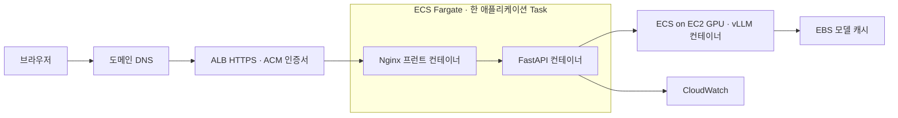

# AWS 컨테이너 배포

작성일: 2026-10-19. 서비스 이름과 저장소 이름은 `orot-ai`로 정한다.

사용자 목표는 도메인·HTTPS·Docker·GitHub Actions CI/CD가 연결된 AWS 서비스에서 테스트하는 것이다. 이전의 AWS 보류 결정을 이 목표로 변경했다. 현재는 파일 준비와 CI 검증 단계이며 실제 AWS 배포나 도메인 구매가 완료된 상태가 아니다.

## 배포 구성



- 프런트와 API는 각각 이미지로 빌드하되 같은 Fargate Task에서 실행한다. Nginx는 `127.0.0.1:8000`의 API를 호출한다. 한 Task 개정에 두 이미지 digest를 함께 기록해 배포·롤백한다.
- 모델 로딩·GPU 추론은 별도 EC2 GPU 환경의 ECS 서비스에서 담당한다. 앱과 모델은 사설 주소로 통신하고 추론 포트를 인터넷에 공개하지 않는다.
- AI 프롬프트·자료 조회·출력 검증은 기존 FastAPI 이미지에 유지한다. 별도 추론 이미지가 모델 실행을 담당한다.
- 모델 가중치는 GPU 저장 공간에서 다운로드·캐시한다. Git과 Docker 앱 레이어에는 넣지 않는다. 모델 저장소·체크포인트 commit·런타임 이미지 digest를 고정한다.
- 현재 CPU/API의 동시 AI 처리 제한과 요청 캐시는 프로세스 단위다. 최초 기준선은 앱 Task 1개·worker 1개로 잡는다. Task 확장 시 공유 제한·중복 처리 정책을 먼저 설계한다.
- 최초 배포는 HTTPS 비밀번호 보호를 지원한다. Nginx의 `SITE_AUTH_MODE`와 Secrets Manager에서 주입한 htpasswd 값으로 설정한다. GPU 호출 API를 무제한 공개하지 않는다. 개인 계정·기기 간 동기화 구현은 별도다.
- Nginx AI 경로에 IP별 분당 6건, burst 2의 기본 요청 제한을 둔다. 기본 기능·검증 요청과 GPU 부하 실험은 구분하고, 실험 시 제한값을 기록한다.

기존 S3·CloudFront 정적 배포안은 프런트도 런타임 컨테이너로 실행하려는 요청에 맞춰 첫 배포 경로에서 제외했다. CDN은 이후 별도 성능 개선 변수로 추가할 수 있다. API Gateway·Lambda·Mangum과 SAM은 이 ECS 배포 경로에 사용하지 않는다.

도메인 구매는 배포의 기술적 필수 조건은 아니다. 이번 서비스의 완료 기준에는 원하는 도메인과 HTTPS 연결을 포함한다. 이름 후보는 `orot-ai.study`이며, 아직 등록 가능 여부·등록/갱신 가격을 확인하거나 구매하지 않았다. 도메인 구매에는 비용 상한과 등록자 정보 확인이 필요하다.

## Git과 이미지 저장소

- GitHub: 소스·Dockerfile·Compose·CI/CD·인프라 설정·평가 코드
- ECR: `orot-ai-web`, `orot-ai-api`, `orot-ai-inference` 이미지
- 릴리스: Git commit SHA로 태그하고 배포에는 `repository@sha256:...` digest 사용
- 비밀: Git에 저장하지 않고 AWS Secrets Manager와 GitHub OIDC를 사용

`.env.local`, `.env.docker`, 가중치, 인증서 개인키, 로컬 캐시는 Git과 Docker 빌드 컨텍스트에서 제외한다. 브라우저 학습 기록은 서버나 GitHub에 올리지 않는다.

## 로컬 Docker

이 Mac에는 Docker가 설치되어 있지 않아 GitHub Actions의 Linux runner에서 CPU 컨테이너를 실제 검증한다. Docker 설치 시 저장소 루트에서 다음 명령을 쓴다.

```sh
docker compose -f ai-study-site/deploy/compose.yml up --build --wait
python3 ai-study-site/deploy/scripts/container_smoke.py
```

주소는 `http://127.0.0.1:5180`이다. API는 별도 호스트 포트로 공개하지 않는다. 기본 Compose는 모델을 실행하거나 다운로드하지 않는다. Mac의 기존 Ollama를 실행하면 `host.docker.internal:11535`로 연결한다. Docker Desktop의 호스트 네트워크 접근 설정에 따라 연결을 확인해야 한다. 모델이 없으면 기본 읽기·퀴즈는 동작하고 AI는 실제 연결 오류를 반환한다.

GPU용 `compose.gpu.yml`은 Linux·NVIDIA Container Toolkit 환경용이다. 모델/GPU 검증 후 환경 파일을 채워 별도로 실행한다. Mac용 GGUF Qwen과 GPU용 체크포인트가 동일한 실행 조건이라고 가정하지 않는다.

## CI

`.github/workflows/ci.yml`은 main push·PR에서 다음 작업을 수행한다.

1. Python 3.12에서 백엔드·배포 입력 검증 테스트
2. Node 22에서 프런트 테스트·TypeScript·운영 빌드
3. 실제 web/API Docker 이미지 빌드 및 Compose health 확인
4. Nginx → FastAPI를 거쳐 전체 본문·문제·직접 주소·오류 응답 HTTP 확인

GPU 추론은 CI에서 실행하지 않는다. 고정 응답의 백엔드 테스트와 실제 CPU 컨테이너 통신 검증이며 AI 품질·GPU 성능을 검증했다고 해석하지 않는다. 각 Action은 공식 저장소의 확인한 commit으로 고정했다.

## CD

`.github/workflows/deploy.yml`은 `DEPLOY_ENABLED=true`를 설정한 뒤 main push의 CI 성공 또는 main의 수동 실행으로 동작한다.

1. 배포할 정확한 commit을 checkout한다. PR과 다른 저장소의 workflow_run은 배포하지 않는다.
2. 테스트와 실제 CPU 컨테이너 통합 점검을 수행한다.
3. GitHub OIDC로 AWS의 배포 Role을 잠시 사용한다.
4. 테스트한 web/API 이미지를 ECR에 push하고 digest를 읽는다.
5. 기존 ECS 애플리케이션 Task에 두 이미지를 함께 반영해 새 개정을 배포한다.
6. 서비스 안정화와 HTTPS `/api/health`, `/release.json`의 commit 일치를 확인한다. 실패하면 이전 Task로 롤백한다.
7. release 결과를 GitHub Actions artifact에 남긴다.

GPU 이미지는 `.github/workflows/inference.yml`에서 검증한 공식 vLLM base digest를 받아 수동 배포한다. 모델 commit과 GPU/메모리 설정은 기존 GPU Task 설정에 있어야 한다. 단일 GPU의 교체 배포는 중단 시간이 발생할 수 있으므로 일반 앱 자동 배포와 구분한다. 이 워크플로는 GPU 하드웨어 호환성·한국어 품질을 보장하지 않는다.

현재 CD는 기존 ECS 서비스에 이미지를 배포하는 코드다. AWS 계정·리전·예산·모델/GPU 결정 뒤 인프라를 생성하고 실제 CD를 검증해야 한다. 설정 파일 존재를 배포 성공으로 기록하지 않는다.

필요한 GitHub 변수:

| 변수 | 값 |
|---|---|
| `DEPLOY_ENABLED` | 실제 인프라 준비 전 `false` 또는 미설정 |
| `AWS_REGION` | 선택한 AWS 리전 |
| `AWS_DEPLOY_ROLE_ARN` | 이 저장소·배포 환경만 신뢰하는 OIDC Role |
| `ECS_CLUSTER` | 클러스터 이름 |
| `ECS_APP_SERVICE` | web/API 애플리케이션 서비스 이름 |
| `ECS_INFERENCE_SERVICE` | 사설 GPU 추론 서비스 이름 |
| `PUBLIC_URL` | 구매·연결한 도메인의 HTTPS 주소 |

OIDC 신뢰 정책은 저장소/소유자와 브랜치 또는 production 환경을 제한해야 한다. 새 저장소의 immutable subject 형식은 실제 GitHub claim과 확인한다. 예시의 저장소 문자열을 그대로 복사해 다른 저장소까지 허용하지 않는다. 배포 Role은 지정한 ECR/ECS·execution role에 필요한 범위로 한정한다.

## 아직 필요한 실제 작업

1. AWS 계정 접근·리전·월 예산 상한, GPU 실행 시간과 종료 정책 결정
2. 큰 모델·체크포인트·라이선스·GPU 메모리·런타임 호환성 검증
3. 네트워크·ECR·IAM OIDC·ECS/EC2·Secrets·CloudWatch·ALB 인프라 생성
4. 도메인 등록 가능 여부와 등록/갱신 가격 확인, 구매·DNS·ACM 연결
5. GPU 서버에서 가중치 다운로드 및 실제 준비 상태 확인
6. 최초 배포와 실제 AI 호출·기록 백업/복원·오류·롤백 검증
7. 성공한 Git SHA와 이미지/model digest를 기준선으로 고정한 후 1~6번 테스트 진행

기본 도메인에서 새 도메인으로 이동하면 IndexedDB는 자동으로 옮겨지지 않는다. 기존 주소의 JSON 백업을 새 주소에서 가져온다.

## 완료 기준

- 도메인 HTTPS에서 읽기·퀴즈·메모·백업과 실제 AI 호출이 동작
- main 변경 → CI → ECR → ECS 배포 → commit 확인이 실제 성공
- 모델 포트 비공개, 비밀 관리, 요청 제한, 지출 관측과 종료 절차 확인
- 실패한 배포의 롤백 검증 및 서버/모델/코드/콘텐츠 버전 기록
- 위 조건을 충족한 배포에서 품질·성능·부하·장애 평가 시작

## 공식 참고

- [Amazon ECR](https://docs.aws.amazon.com/AmazonECR/latest/userguide/what-is-ecr.html)
- [GitHub Actions에서 ECS 배포](https://docs.github.com/en/actions/how-tos/deploy/deploy-to-third-party-platforms/amazon-elastic-container-service)
- [GitHub OIDC와 AWS](https://docs.github.com/en/actions/how-tos/secure-your-work/security-harden-deployments/oidc-in-aws)
- [ECS GPU 작업](https://docs.aws.amazon.com/AmazonECS/latest/developerguide/ecs-gpu.html)
- [ALB HTTPS](https://docs.aws.amazon.com/elasticloadbalancing/latest/application/create-https-listener.html)
- [vLLM Docker 배포](https://docs.vllm.ai/en/stable/deployment/docker/)
