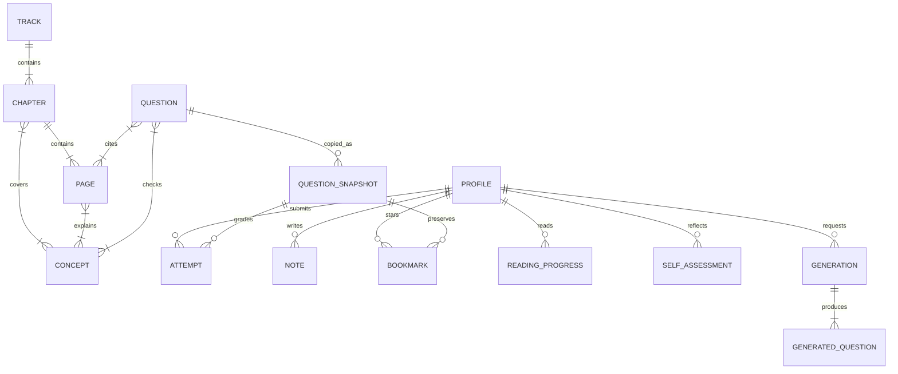

# 1단계: 목차·콘텐츠·문제·기록 데이터 설계

- 설계·스키마 버전: `1.0.0`
- 콘텐츠 버전: `1.0.0`
- 범위: [서비스 아키텍처](../service-architecture.md)의 「11. 개발 순서와 완료 기준」 중 1번
- 완료 기준: 모든 목차·본문·문제·개념과 개인 기록이 ID로 연결되고, 실제 변환 결과와 예시 기록의 연결을 검증할 수 있다.
- 상태: 데이터 설계·실제 콘텐츠 변환·검증 완료. 웹 화면·IndexedDB 저장 구현·AI API 호출·배포는 다음 단계다.

## 1. 결과물

| 파일 | 용도 |
| --- | --- |
| [콘텐츠 전체 JSON](data/content-bundle.json) | 8개 트랙·32개 챕터·96개 페이지·215개 개념·102개 문제의 실제 데이터 |
| [목차·색인 JSON](data/curriculum.json) | 본문 전체를 읽지 않고 목차·순서·개념 연결 조회 |
| `data/pages/CHxx-Pxx.json` | 페이지 단위로 불러올 본문 96개 |
| `data/quizzes/CHxx.json` | 챕터별 객관식 2개와 인출 연습 1개, 총 32개 파일 |
| [종합 문제](data/capstones.json) | 여러 챕터에 연결된 서술형 종합 문제 6개 |
| [JSON Schema](schema/data-contract.schema.json) | 콘텐츠·문제·개인 기록·AI 요청·응답의 자료형과 필수 필드 |
| [페이지·문제별 개념 매핑](concept-map.json) | 원고의 넓은 챕터 태그를 페이지·객관식 단위로 구체화한 편집 자료 |
| [개인 기록 백업 예시](examples/learning-backup.json) | 메모·풀이·별표·진행·인출 자기평가·생성 문제 연결 예시 |
| [공부 도우미 요청](examples/tutor-request.json) / [응답](examples/tutor-response.json) | 다음 단계에서 구현할 API 계약 |
| [AI 복습 요청](examples/review-request.json) / [응답](examples/review-response.json) | 세 문제 생성과 로컬 기록 연결 계약 |
| [검증 결과](validation-report.json) | 실제 데이터 검증과 15개 오류 거부·행동 점검 결과 |

예시의 사용자·시간·모델명·생성 결과는 형식 설명용 가상 자료다. 실제 사용 이력이나 AI 호출 결과가 아니다. 특히 `example-only-no-api-call`은 실제 모델 이름이 아니다.

## 2. 원본과 생성 파일

학습 원본은 [트랙별 Markdown](../learning-content/README.md)이다. 원고를 수정한 뒤 빌더로 JSON을 재생성한다. 생성된 JSON을 직접 고치면 다음 빌드에서 덮어쓰므로 콘텐츠 수정은 원본에 반영한다.

```text
learning-content/*.md + concept-map.json
  → build_content.py
    → content-bundle.json
    → curriculum.json
    → pages/*.json
    → quizzes/*.json
    → capstones.json

build_contracts.py
  → data-contract.schema.json
  → 형식 설명용 examples/*.json

validate_data.py
  → 스키마·관계·리비전·기록·오류 거부 검증
  → validation-report.json
```

표준 라이브러리만으로 변환·스키마 생성을 실행할 수 있다. 검증에는 Python의 `jsonschema` 패키지가 필요하다. 아래 명령은 이 설계서가 있는 디렉터리에서 실행한다.

```sh
python3 build_content.py
python3 build_contracts.py
python3 validate_data.py
```

`build_contracts.py`는 예시 파일을 다시 만든다. 실제 사용자 백업이나 운영 기록을 `examples/`에 보관하지 않는다. 세 명령은 서버를 실행하거나 외부 AI API를 호출하지 않는다.

## 3. ID 규칙

| 대상 | 형식 | 예시 |
| --- | --- | --- |
| 트랙 | `T` + 2자리 번호 | `T01` |
| 챕터 | `CH` + 2자리 번호 | `CH08` |
| 학습 페이지 | 챕터 ID + `-P` + 번호 | `CH08-P01` |
| 기본 객관식 | 챕터 ID + `-Q` + 번호 | `CH08-Q01` |
| 인출 연습 | 챕터 ID + `-R` + 번호 | `CH08-R01` |
| 종합 문제 | `CAP` + 2자리 번호 | `CAP01` |
| 개념 | 소문자 영문 kebab-case | `precision`, `data-leakage` |
| 참고 자료 | URL의 SHA-256 앞 12자리 | `SRC-…` |
| AI 생성 문제 | `GQ-` + UUID | `GQ-xxxxxxxx-…` |
| 선택지 | 문제 ID + `:` + A~D | `CH08-Q01:B` |
| 로컬 프로필 | `LP-` + UUID | `LP-xxxxxxxx-…` |
| 풀이·메모·별표 | `ATT-`·`NOTE-`·`BKM-` + UUID | 각 기록마다 별도 ID |
| 읽기·인출 평가·생성 실행 | `READ-`·`SELF-`·`GEN-` + UUID | 각 기록마다 별도 ID |
| 요청 | `REQ-` + UUID | AI 호출 추적 ID |

이미 발행한 ID는 제목이나 화면 위치가 바뀌어도 유지하고 삭제한 ID를 다른 내용에 재사용하지 않는다. 현재 번호는 학습 순서와 일치하지만 영구적인 정렬 키로 사용하지 않는다. 표시 순서는 `order`, `chapter_ids`, `page_ids`로 결정한다. 예시 UUID는 재생성의 안정성을 위해 고정값이며, 실제 새 기록은 충돌하지 않는 UUID로 생성한다.

## 4. 데이터 관계



관계도의 `QUESTION`에는 객관식과 인출·종합 문제가 포함된다. 자동 채점 `ATTEMPT`는 객관식 스냅샷에만 연결하고, 서술형은 `SELF_ASSESSMENT`로 연결한다. AI 생성 문제는 객관식 QUESTION과 같은 구조를 쓰며 별도 원본 구분과 생성 실행 ID를 가진다.

### 핵심 연결 예

```text
T02
 └─ CH08
     ├─ CH08-P01 ─ precision / recall / confusion-matrix / f1
     ├─ CH08-P02 ─ roc-auc / pr-curve / threshold
     ├─ CH08-P03 ─ error-analysis
     ├─ CH08-Q01 ─ CH08-P01, recall / confusion-matrix
     ├─ CH08-Q02 ─ CH08-P02, precision / recall / threshold
     └─ CH08-R01 ─ CH08의 세 페이지와 해당 챕터 개념

메모 ─ 페이지 또는 개념 또는 문제 ID
풀이 ─ 문제 ID + 문제 리비전 + 그 당시 문제 전체
별표 ─ 문제 ID + 문제 리비전 + 저장한 문제 전체
복습 요청 ─ 오답에서 추린 개념 ID + 관련 페이지 ID
```

인출 연습의 `concept_ids`는 챕터 전체를 복습한다는 범위 표시다. 모든 개념을 한 문항이 개별 측정했다는 뜻은 아니다. 일부 객관식은 다른 챕터에서 배운 개념을 함께 연결한다. 개념별 통계에서 객관식 정오와 서술형 자기평가를 섞지 않는다.

## 5. 콘텐츠 모델

### Track · Chapter · Page

- Track: 제목·순서·소개·챕터 ID·참고 자료 ID·원본 경로
- Chapter: 트랙 ID·순서·선수 챕터 ID·학습 목표·개념 ID·페이지 ID·문제 ID
- Page: 챕터 ID·순서·개념 ID·제목·`body_markdown`·이전/다음 페이지 ID

이전/다음은 전체 96페이지를 따라 연결하며 첫 페이지의 이전, 마지막 페이지의 다음은 `null`이다. 챕터 끝 퀴즈를 언제 보여줄지는 화면 흐름에서 처리한다. 목차와 본문은 분리되어 처음부터 모든 본문을 내려받을 필요가 없다.

Page 본문에서 문제·정답·참고 자료 영역을 제외하고, 원고의 코드 블록과 수식을 보존했다. Markdown 문자열은 웹 화면에서 안전하게 렌더링하며 임의 HTML 실행과 분리한다.

### Concept

각 개념은 챕터·페이지·문제의 역방향 ID 목록을 가진다. 같은 개념이 여러 챕터에 등장해도 하나의 개념 ID를 사용한다. 예를 들어 `rag`는 기초 트랙과 RAG 트랙을 함께 연결한다.

현재 개념 카탈로그는 215개 ID와 연결 관계를 제공한다. 개념의 설명은 연결된 본문에 있으며, 별도 용어 사전 정의를 자동으로 만들어 넣은 것은 아니다.

### Question

| 필드 | 의미 |
| --- | --- |
| `id`, `revision` | 문제의 영구 ID와 불변 내용 버전 |
| `format` | `single_choice` 또는 `self_explanation` |
| `origin` | `authored` 또는 `generated` |
| `chapter_ids`, `concept_ids` | 학습·복습 연결 |
| `source_page_ids` | 해설의 관련 학습 페이지 |
| `prompt_markdown` | 질문 본문 |
| `category` | 원고의 개념 구분·계산·상황 판단 등 유형 |
| `difficulty` | 현재 기본 문제는 `not_rated`; 검증하지 않은 난이도를 임의 부여하지 않음 |
| `options` | 객관식 보기 네 개와 각각의 고유 ID |
| `correct_option_id` | 객관식 정답 보기 ID |
| `explanation_markdown` | 객관식 정답·오해 해설 |
| `expected_answer_markdown` | 인출·종합 문제의 설명 기준 |
| `grading` | 서술형은 `self_assessment` |
| `generation_id` | AI 생성 문제의 생성 실행; 기본 객관식은 `null` |

102문항은 객관식 64개, 챕터 인출 연습 32개, 종합 문제 6개다. 서술형에 객관식 정오를 붙이지 않는다. 기본 문제는 브라우저에서 채점하므로 정답 데이터가 클라이언트에 전달된다. 개인 학습용 구조이며 정답을 숨겨야 하는 감독 시험용 설계가 아니다.

### 선택지 ID와 표시 순서

정답은 배열의 0·1·2·3번째 위치가 아니라 옵션 ID로 저장한다. 화면에서 보기를 섞으면 A~D는 표시 순서로 다시 붙이고, 제출 시 선택한 옵션 ID를 기록한다. `displayed_option_ids`도 함께 저장해 당시 표시 순서를 재현한다.

`CH01-Q01:B`의 B는 원본 옵션의 식별자 일부다. 화면에서 항상 B로 표시해야 한다는 뜻은 아니다. 보기 문구·정답 의미가 바뀌면 문제 리비전을 갱신한다.

## 6. 버전·리비전·불변 스냅샷

| 값 | 목적 |
| --- | --- |
| `schema_version` | 데이터 형식·가져오기 호환성 |
| `content_version` | 사람이 관리하는 콘텐츠 릴리스 버전 |
| `release_id` | 전체 콘텐츠 묶음의 정확한 해시 |
| `revision` | 개별 트랙·챕터·페이지·문제의 정확한 해시 |

해시는 키 정렬·UTF-8·공백 없는 JSON 직렬화에 SHA-256을 적용한다. 개별 리비전 계산에서는 `revision` 자체를, 전체 릴리스 계산에서는 `release_id` 자체를 제외한다. 줄바꿈이나 본문·연결 정보가 달라지면 해시가 바뀔 수 있다. 빌드 시각을 넣지 않아 같은 원본은 같은 결과를 만든다.

풀이·별표·인출 자기평가는 `question_ref`와 `question_snapshot`을 함께 가진다. 스냅샷에는 당시 문제·보기·정답·해설·근거가 들어간다. 최신 문제를 가져와 과거 풀이를 다시 채점하지 않는다. 같은 ID의 새 리비전은 예전 리비전과 다른 복습 대상으로 취급한다.

본문이 바뀌면 이전 읽기 완료 기록은 예전 리비전에 남기고 새 페이지는 변경됨으로 표시할 수 있다. 메모는 삭제하지 않고 인용 구간이 다시 연결되는지 확인한다. 문서가 삭제되어 현재 ID를 찾을 수 없어도 메모·스냅샷을 보존하고 연결 상태를 `missing`으로 진단한다.

## 7. 개인 기록과 IndexedDB 설계

기록의 소유자는 `profile_id`로 연결한다. 이는 브라우저 안의 학습 기록을 구분하는 로컬 ID이며 계정 인증이나 서버 권한 증명이 아니다.

| 저장소 | 키·조회 기준 | 역할 |
| --- | --- | --- |
| profiles | 프로필 ID | 표시 이름·생성/수정 시각 |
| attempts | 풀이 ID; 프로필·문제 ID·리비전·제출 시각 | 매번의 객관식 선택과 정오 |
| notes | 메모 ID; 프로필·대상 종류·대상 ID·수정 시각 | 페이지·개념·문제에 대한 메모 |
| bookmarks | 별표 ID; 프로필·문제 ID·리비전 조합 유일 | 저장된 문제 모아보기 |
| readingProgress | 읽기 기록 ID; 프로필·페이지 ID·리비전 조합 유일 | 시작·완료 상태 |
| resume | 프로필 ID 유일 | 마지막 페이지와 0~1 스크롤 위치 |
| selfAssessments | 기록 ID; 프로필·문제·제출 시각 | 서술 응답과 `again`·`partial`·`understood` |
| generations | 생성 실행 ID; 프로필·요청 ID | 모델·프롬프트·개념·생성 문제 목록 |
| generatedQuestions | 생성 문제 ID | 새 문제 전체 보관 |

위 표는 저장·조회 계약이다. 실제 Dexie DB 생성·트랜잭션·마이그레이션 코드는 이후 저장 기능 구현에서 작성한다.

### 메모의 연결과 인용

`target`은 페이지·개념·문제 중 하나다. 페이지나 문제에는 리비전도 포함한다. 인용 메모는 `quote_anchor`에 페이지 참조와 원문 일부 `exact`, 앞뒤 문맥 `prefix`·`suffix`를 저장한다. 고정 글자 오프셋만 저장해 수정 후 엉뚱한 구간에 붙는 문제를 피한다.

렌더링된 글과 Markdown 원본의 강조 기호·공백은 다를 수 있으므로, 실제 선택 문장 추출·재연결 구현에서는 정규화 규칙을 정해야 한다. 연결이 모호하거나 원문이 바뀌면 메모를 보존하고 원래 인용문을 보여준다. 예시 검증은 원본 문자열과 일치하는 인용을 사용한다.

### 오답노트와 다시 풀기

별도의 정오 수치를 여러 곳에 중복 저장하지 않고 풀이 이력에서 계산한다.

1. 프로필·문제 ID·리비전으로 풀이를 묶는다.
2. `submitted_at`으로 정렬하고 같은 시각이면 풀이 ID로 순서를 정한다.
3. 한 번이라도 틀렸으면 오답 이력에 남긴다.
4. 가장 최근 풀이가 오답이면 다시 풀 대상이다.
5. 다시 맞혔으면 다시 풀 대상에서는 제외하되 이전 오답은 삭제하지 않는다.

정답 여부는 선택 ID와 당시 스냅샷으로 다시 계산한다. 백업의 `is_correct`가 이 계산과 다르면 손상된 기록으로 거부한다. 인출 연습은 자기평가로 따로 복습하고 객관식 성공률의 분모에 넣지 않는다.

### 읽기 완료와 챕터 완료

스크롤만으로 자동 완료했다고 가정하지 않고 명시적인 완료 동작을 저장한다. 현재 리비전의 모든 페이지를 읽었는지는 읽기 완료, 챕터 문제를 풀었는지는 퀴즈 시도, 정답 여부는 이해 점검으로 분리한다. 이 셋을 하나의 진도율로 섞지 않는다.

### 내보내기·가져오기 정책

- 백업은 한 프로필의 기록과 필요한 문제 스냅샷·생성 결과를 포함한다.
- 스키마 및 고유 키·소유 프로필·스냅샷·채점 일관성을 검증한다.
- 현재 지원 버전은 `1.0.0`이다. 미지원 버전은 임의로 해석하거나 기존 데이터를 덮지 않는다.
- 현재 콘텐츠와 다른 기록은 `outdated`·`missing` 연결을 진단하되 원문 메모와 과거 문제는 보존한다.
- 같은 불변 기록 ID에 다른 내용이 있으면 충돌로 처리한다. 조용히 덮어쓰지 않는다.
- 실제 가져오기에서는 검증 후 트랜잭션으로 저장하고 실패 시 일부 기록만 남지 않도록 한다.

현재 결과물은 이 정책의 데이터 형식과 검증기를 제공하며 IndexedDB 가져오기 실행 기능까지 구현한 것은 아니다.

## 8. AI API 데이터 계약

### 공부 도우미: POST /api/ai/tutor

요청에는 릴리스 ID·페이지 ID·사용자 질문·선택 문장·최근 대화를 보낸다. 최근 대화의 허용 역할은 `user`와 `assistant`이며 클라이언트가 서버의 `system`·`tool` 역할을 주입하지 못하게 한다.

서버는 페이지 ID로 해당 버전의 학습자료를 조회한다. 최근 대화는 사용자 입력으로 취급하고 실제 권한이나 신뢰된 지시로 쓰지 않는다. 요청의 문자 제한 외에 모델 토큰 예산도 서버에서 적용한다.

응답은 설명 Markdown·근거 페이지 ID·모델·프롬프트 버전·요청 ID를 포함한다. `grounded` 응답은 근거가 있어야 하며, 자료로 답할 수 없으면 `insufficient_context`로 구분한다. 이 필드가 있다고 사실성이 입증된 것은 아니므로 내용 평가는 별도로 한다.

### AI 복습: POST /api/ai/review-quiz

클라이언트가 선택 주제나 오답 기록에서 개념 ID를 추린다. 요청은 개념 최대 5개·선택 근거 페이지 최대 10개·난이도·문제 수 3개를 포함한다. 전체 노트나 풀이 백업을 자동 전송하지 않는다. 서버는 허용 개념·페이지와 릴리스 ID를 검증하고 필요한 자료를 직접 읽는다.

응답 문제는 기본 객관식과 같은 구조다. 서버가 생성 ID·문제 ID·리비전을 부여하고 스키마와 근거 ID를 검증한다. 생성 결과는 `unreviewed`로 저장한다. 새 문제의 사실성·정답 유일성·교육 품질은 별도 평가 대상이다.

릴리스가 다르면 서로 다른 본문을 참고한 채 응답하지 않고 `CONTENT_VERSION_MISMATCH` 같은 오류로 갱신을 유도한다. 구체적인 HTTP 오류 응답 구현은 API 단계에서 진행한다. 가상 응답 예시는 스키마·연결 설명용이며 생성 품질의 평가 샘플로 쓰지 않는다.

## 9. 검증 범위와 완료 판단

JSON Schema는 자료형·필수 값·개수·허용 역할·ID 모양을 검사한다. `validate_data.py`는 스키마만으로 확인하기 어려운 실제 관계와 동작을 검사한다.

- 트랙↔챕터↔페이지 소유 관계와 정렬
- 선수 학습의 존재 및 순환 방지
- 페이지 이전/다음 연결
- 215개 개념의 역방향 연결
- 문항의 근거 페이지·개념·챕터 존재
- 보기 ID 소유·중복과 정답 ID 존재
- 리비전·콘텐츠 릴리스 해시
- 풀이·별표의 불변 스냅샷과 소유 프로필
- 오답 재풀이 후 상태 변화와 이력 보존
- 개정 후 과거 문제 보존·연결 상태 진단
- 버전 불일치·조작된 정오·클라이언트 시스템 역할 등 거부
- 분리한 페이지·퀴즈 파일과 전체 묶음의 일치

검증은 실제 콘텐츠 전체와 예시 기록에 통과했다. 사용자 기록 예시는 모든 연결이 현재 콘텐츠에 해소된다. 이 단계의 완료는 형식과 연결이 준비되었다는 뜻이며 UI 동작·DB 지속성·실제 AI 품질·배포 성공의 검증과 구분한다.

## 10. 다음 단계에서 사용하는 방법

1. React는 `curriculum.json`으로 목차를 만들고 페이지 ID로 `pages/`의 본문을 불러온다.
2. 챕터 퀴즈는 `quizzes/`를 읽어 객관식과 인출 문제를 구분한다.
3. 개인 저장 기능은 스키마의 기록 형식과 중복 키 규칙을 따른다.
4. Python API는 같은 릴리스의 콘텐츠 묶음에서 ID로 자료를 조회한다.
5. AI 출력은 요청 버전·스키마·근거 ID를 검증한 뒤 브라우저에 전달한다.

새 설계 문서와 JSON은 다음 구현을 위한 입력이다. 이 작업에서 계정 설정·API 키 발급·클라우드 리소스 생성은 수행하지 않았다.
