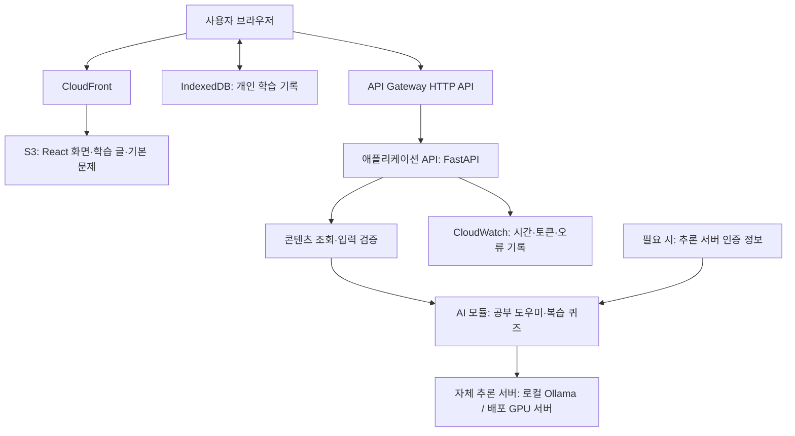

# AI Engineer 학습 사이트 서비스 아키텍처

- 작성일: 2026-10-18
- 상태: 로컬 구현·검증 완료. 2026-10-19 사용자 요청으로 Docker·GitHub CI/CD·AWS·도메인 HTTPS 배포를 진행하는 목표로 변경. 실제 클라우드 배포는 아직 미완료
- 목표: 읽기 → 퀴즈 → 오답 복습으로 이어지는 개인 학습 사이트를 만들고, AI 기능을 대상으로 성능 개선 실험을 진행한다.
- 개발 목표: 내일까지 요청한 전체 기능을 구현하고 배포한다. 전체 교육 콘텐츠의 정확성 검수는 별도 작업으로 관리하며, 완료 여부는 실제 검증 결과로 판단한다.

## 0. 현재 배포 결정 — 2026-10-19 갱신

사용자는 도메인·HTTPS·파트별 Docker 이미지·GitHub CI/CD가 연결된 AWS 배포를 먼저 완료하고 그 환경에서 1~6번 평가를 진행하기로 했다. 아래 초기 S3·CloudFront/Lambda 배포안과 AWS 보류 기록은 이전 단계의 기록이며, 현재 배포 목표는 이 절과 [컨테이너 배포 문서](ai-study-site/deploy/README.md)가 우선한다.

- 서비스·저장소 이름: `orot-ai`, GitHub는 우선 비공개
- 프런트: Nginx 컨테이너, API: FastAPI 컨테이너. 각각 이미지를 만들고 ECS Fargate의 한 Task에서 실행·배포·롤백
- 모델 추론: ECS on EC2 GPU의 별도 vLLM 컨테이너, 가중치는 GPU 저장소에 다운로드·캐시
- HTTPS 진입: 도메인 DNS → ACM 인증서가 연결된 ALB → 프런트 → 같은 Task의 API → 사설 GPU 추론 서버
- 이미지: ECR. Git에는 소스·Dockerfile·CI/CD와 인프라 설정을 보관
- CI/CD: GitHub Actions + AWS OIDC. 실제 인프라 구성 전 자동 AWS 배포는 비활성화
- 관측: CloudWatch, 릴리스 Git SHA·이미지 digest·모델 commit·콘텐츠 버전
- 현재는 Docker·CI/CD 준비 단계다. AWS 리전·예산·GPU/모델·도메인은 실제 확인과 설정이 남아 있다.

## 1. 서비스 범위

1. AI Engineer가 알아야 할 AI·머신러닝·딥러닝·NLP·LLM·RAG 관련 전체 커리큘럼 구성
2. 비슷한 개념을 트랙·챕터로 묶는 학습 구조
3. 예시와 비유를 활용한 긴 설명 글
4. 개념 단위로 페이지를 넘기는 읽기 화면
5. 챕터별 기본 퀴즈와 채점·정답·해설
6. 개념 메모장, 오답노트, 오답 재풀기, 별표 문제 모아보기
7. 현재 학습 내용을 바탕으로 돕는 AI 공부 도우미
8. 선택한 주제와 틀린 개념에 기반한 AI 복습 퀴즈

기본 학습 문제는 검토된 고정 콘텐츠로 관리한다. AI 생성 문제는 기본 문제와 구분하고 오류 신고 기능을 제공한다.

## 2. 주요 설계 결정

### 사용자 요청에 따른 모델 실행 방식 변경

기존 외부 OpenAI API 계획을 변경했다. 이미 다운로드한 Qwen으로 로컬 연결과 기능을 먼저 테스트하고, 큰 모델을 배포할 때 그 실행 환경에서 가중치를 다운로드해 직접 서빙한다. OpenAI API 키 설정은 현재 작업에 필요하지 않다.

- 확인한 로컬 모델: `qwen3.5:9b-q4_K_M` (9.0B, GGUF, Q4_K_M)
- 로컬 실행: React → FastAPI → Ollama → Qwen
- 큰 모델의 배포 후보: S3·CloudFront → 애플리케이션 API → 사설 GPU 추론 서버(vLLM 등)
- 모델 서버 교체는 서버 측 provider·주소·모델 설정으로 처리한다.
- 로컬 테스트의 시간·품질·메모리 결과는 큰 모델의 결과와 별도로 기록한다.

- 프런트엔드는 React 기반 정적 사이트로 배포한다.
- 백엔드는 Python과 FastAPI를 사용한다.
- 일반 백엔드와 AI 백엔드는 코드 모듈로 역할을 나눈다. 현재는 로컬 FastAPI 프로세스에서 실행하며 모델은 별도 Ollama 프로세스가 담당한다.
- 개인 기록은 IndexedDB에 저장한다. 첫 버전은 로그인과 기기 간 자동 동기화를 제공하지 않는다.
- 콘텐츠는 Markdown과 JSON으로 관리하고, 프런트엔드와 서버가 같은 원본과 콘텐츠 버전을 사용한다.
- AI 기능은 서버를 통해 자체 모델 서버를 호출한다. 추론 서버의 주소·모델 설정·향후 인증 정보는 서버에서 관리한다.
- 첫 버전의 AI 요청은 동기 응답 방식으로 구성한다. 긴 생성 작업이 필요해지면 비동기 작업 방식으로 확장한다.
- 프런트의 AWS 배포 후보는 S3·CloudFront다. 큰 모델은 GPU 서버에서 실행한다. API를 컨테이너로 배포할지, API Gateway·Lambda 어댑터를 유지할지는 실제 추론 시간과 부하에 맞춰 확정한다.

## 3. 기술 스택

| 영역 | 기술 | 역할과 선택 이유 |
| --- | --- | --- |
| 프런트엔드 | React + TypeScript + Vite | 학습·퀴즈 화면 구현 및 정적 빌드 |
| UI | Tailwind CSS + shadcn/ui | 읽기 화면, 탭, 메모장, 대화 패널의 디자인 구성 |
| 화면 이동 | React Router | 목차·학습·복습·노트 화면과 개별 학습 페이지 주소 관리 |
| 학습 콘텐츠 | Markdown + 메타데이터 JSON | 긴 글과 연결 정보를 코드에서 분리해 관리 |
| 콘텐츠 표시 | react-markdown + KaTeX | 본문·코드·수식 표시 |
| 개인 기록 | IndexedDB + Dexie | 메모·풀이 기록·오답·별표·학습 진행 저장 |
| 백엔드 | Python + FastAPI + Pydantic | API 구현, 입력·출력 검증, 오류 처리 |
| AI 백엔드 | Python 내부 AI 모듈 + httpx | 로컬 Ollama 및 자체 GPU 서버의 호환 API 호출 |
| 로컬 모델 | Ollama + Qwen3.5 9B Q4_K_M | 기존 다운로드 모델로 연결·기능 검증 |
| 큰 모델 배포 | GPU 서버 + vLLM 등 | 배포 환경에서 체크포인트를 다운로드하고 직접 추론 |
| Lambda 연결(선택) | Mangum | Lambda 배포를 선택할 경우에만 사용 |
| 프런트 배포 | S3 + CloudFront | 정적 파일과 콘텐츠의 HTTPS 제공 |
| API 배포 후보 | FastAPI 컨테이너 또는 API Gateway + Lambda | 실제 추론 시간·동시성·응답 방식에 따라 확정 |
| 비밀 관리(필요 시) | AWS Secrets Manager | 자체 추론 서버의 인증 정보 보관 |
| 관측·성능 실험 | CloudWatch + k6 | 요청 기록, 지연·실패·동시성 측정 |
| 인프라 관리 | AWS SAM | 인프라를 파일로 관리하고 재현 가능한 배포 수행 |

모델명과 라이브러리의 구체적인 버전은 구현 시 확정하고 잠금 파일 및 설정에 기록한다.

## 4. 전체 아키텍처



위 도식의 API Gateway는 Lambda 어댑터를 채택할 경우의 배포 경로다. 긴 추론을 직접 처리하는 컨테이너 API를 선택하면 ALB 등의 진입점으로 바꾼다. 현재 로컬 검증은 Vite 프록시 → FastAPI → Ollama로 수행했다.

### 요청 흐름

- 기본 학습: 브라우저 → CloudFront → S3 → 글·기본 문제 표시
- 개인 기록: 브라우저에서 IndexedDB를 읽고 수정
- AI 기능(현재): 브라우저 → Vite 프록시 → FastAPI → AI 모듈 → 로컬 Qwen → 브라우저
- AI 기능(배포 후보): 브라우저 → API 진입점 → FastAPI → 사설 GPU 추론 서버 → 결과 검증 → 브라우저

### 일반 백엔드와 AI 백엔드의 경계

일반 백엔드는 요청 검증, 콘텐츠 조회, 오류 응답, 로그를 담당한다. AI 모듈은 문맥 구성, 프롬프트, 모델 호출, 생성 결과 검증을 담당한다.

현재 일반 API와 AI 통신 모듈은 같은 FastAPI 앱에 있고, 모델 로딩·추론은 별도 프로세스가 담당한다. 이후 API의 실행 환경을 바꿔도 모델 서버와의 통신 경계를 유지한다.

## 5. 프런트엔드 설계

### 화면 구성

| 공간 | 주요 기능 |
| --- | --- |
| 학습하기 | 전체 목차, 페이지별 읽기, 이전·다음, 진행률, 이어 읽기, 챕터 퀴즈 |
| 복습하기 | 오답 재풀기, 별표 문제, 주제별 AI 복습 퀴즈 |
| 내 노트 | 개념별 메모 작성·검색, 관련 글과 문제로 이동 |
| 공부 도우미 | 학습 화면 옆 대화 패널, 현재 페이지·선택 문장 질문 |

### 읽기 화면

```text
┌────────────┬──────────────────────────┬──────────────┐
│            │ 챕터 / 현재 페이지       │              │
│ 전체 목차  │                          │ 공부 도우미  │
│            │ 제목                     │              │
│ 학습 진행  │ 설명·비유·예시·코드·수식 │ 질문 입력    │
│            │                          │              │
│            │ 메모하기 / 핵심 정리     │              │
│            │ 이전       3 / 8    다음 │              │
└────────────┴──────────────────────────┴──────────────┘
```

- 글은 화면 높이로 임의 분할하지 않고 개념 단위로 나눈다.
- 모바일에서는 목차와 공부 도우미를 필요할 때 여는 패널로 제공한다.
- 콘텐츠를 페이지·챕터별로 나누어 필요한 시점에 불러온다.
- 개별 학습 페이지 주소로 직접 접속하거나 새로고침해도 정상적으로 열린다.

### 실행 위치

| 브라우저에서 처리 | 서버에서 처리 |
| --- | --- |
| 페이지 이동, 기본 문제 채점, 메모, 오답·별표·진행률 | 공부 도우미 답변, AI 복습 퀴즈 생성 |

기본 학습 기능은 AI 응답과 독립적으로 사용할 수 있게 한다.

## 6. 콘텐츠 및 데이터 설계

### 콘텐츠 계층

```text
트랙 → 챕터 → 학습 페이지 → 관련 개념·문제

예: 머신러닝
     └─ 모델의 일반화
         ├─ 학습 성능과 실제 성능은 왜 다를까?
         ├─ 과적합과 과소적합
         ├─ 학습·검증·테스트 데이터
         └─ 개념 확인 퀴즈
```

각 페이지·개념·문제에 고유 ID를 부여한다. 메모·오답·별표·AI 문맥은 이 ID로 연결한다.

### 데이터 종류

| 데이터 | 주요 필드 |
| --- | --- |
| 학습 페이지 | 페이지 ID, 챕터 ID, 개념 ID, 본문, 콘텐츠 버전 |
| 기본 문제 | 문제 ID, 개념 ID, 보기, 정답, 해설, 관련 페이지, 문제 버전 |
| 풀이 기록 | 문제 ID·버전, 선택한 답, 정오 여부, 풀이 시각 |
| 메모 | 관련 페이지·개념 ID, 본문, 수정 시각 |
| 별표 | 문제 ID 또는 저장된 생성 문제 참조 |
| 학습 진행 | 읽은 페이지, 마지막 위치, 완료한 챕터 |
| AI 생성 문제 | 생성 ID, 문제·보기·정답·해설 전체, 근거 페이지 ID, 생성 설정·버전 |

### 저장 정책

- 학습 글과 기본 문제: 저장소의 Markdown·JSON 원본으로 관리한다.
- 프런트와 서버: 같은 콘텐츠 원본을 빌드에 포함하고 버전을 확인한다.
- 개인 기록: Dexie를 통해 IndexedDB에 저장한다.
- 개인 기록의 JSON 내보내기·가져오기를 제공한다.
- AI 문제는 별표·오답 재풀기가 가능하도록 생성 결과 전체를 보관한다.
- 기본 문제가 수정되어도 과거 기록을 해석할 수 있도록 풀이 당시 버전과 필요한 문제 정보를 보존한다.

첫 버전은 브라우저·기기별 저장이다. 브라우저 데이터를 삭제하면 기록이 사라질 수 있으며, 기기 간 자동 동기화는 제공하지 않는다.

향후 계정·동기화를 추가할 때 저장소 구현을 바꿀 수 있도록 화면과 저장 로직을 분리한다. 서버 DB와 로그인 기술은 그 확장 시점에 결정한다.

## 7. 일반 백엔드 설계

### 처리 단계

```text
요청 검증 → 필요한 학습자료 조회 → AI 처리 → 결과 검증 → 응답·로그 기록
```

| API | 역할 |
| --- | --- |
| GET /api/health | 배포 상태 확인 |
| GET /api/meta | API·콘텐츠 버전 확인 |
| POST /api/ai/tutor | 학습 내용 관련 질문 답변 |
| POST /api/ai/review-quiz | 선택한 개념의 복습 문제 생성 |

- 브라우저는 페이지·개념 ID를 전달하고, 서버는 배포된 콘텐츠에서 관련 자료를 찾는다.
- 선택 문장과 사용자 질문은 별도 사용자 입력으로 다루고 길이·형식을 검증한다.
- 프런트와 서버의 콘텐츠 버전 불일치를 확인할 수 있게 한다.
- 오류 응답에는 사용자용 안내와 요청 ID를 포함한다.

### 오류 분류

- 입력 오류
- 존재하지 않는 학습자료
- 요청 제한
- AI 응답 시간 초과
- 모델 제공자 오류
- 생성 결과 검증 실패

화면에는 이해할 수 있는 안내와 다시 시도 버튼을 제공하고, 상세 원인은 로그에서 확인한다.

## 8. AI 백엔드 설계

### 공부 도우미

- 입력: 현재 페이지 ID, 선택 문장, 질문, 길이가 제한된 최근 대화
- 문맥: 서버가 현재 페이지와 연결된 개념 자료를 조회해 구성
- 출력: 설명, 예시, 관련 학습 페이지
- 빠른 질문: 다른 비유로 설명, 예시 추가, 힌트 요청

처음에는 개념 ID와 연결 정보를 이용해 자료를 조회한다. 전체 문서 대상 의미 검색이 필요해질 때 임베딩·벡터 검색을 추가한다.

### AI 복습 퀴즈

- 입력: 선택 개념 ID, 틀린 개념 목록, 난이도
- 출력: 새 문제 3개, 보기, 정답, 해설, 근거 페이지 ID
- 오답 재풀기는 기존 문제를 다시 푸는 기능이고, AI 복습 퀴즈는 같은 개념의 새 문제를 생성하는 기능이다.

### 생성 결과 검증

- 모델 서버의 JSON Schema 출력 제약과 Python 검증을 함께 사용한다. 공부 도우미와 복습 문제 생성에 적용한다.
- 서버에서 문제 수·보기 수·정답 번호·중복·필수 해설을 검사한다.
- 근거 페이지 ID가 실제 콘텐츠에 존재하는지 확인한다.
- 생성 후 같은 로컬 모델에 별도 검토 프롬프트를 보내 정답·해설·주제·근거를 대조한다. 한 문제라도 통과하지 못하면 세트 전체를 반환하지 않는다.
- 생성과 검토 두 호출이 하나의 전체 시간 제한을 공유하며, 두 호출의 시간·토큰과 검토 프롬프트 버전을 기록한다.
- 스키마 준수는 정답 정확성을 보장하지 않으므로 별도 내용 평가와 오류 신고가 필요하다.
- 모델의 자동 검토도 오류가 있을 수 있다. 생성 문제는 사람 검토 전 `unreviewed`로 보관한다.

### 모델·프롬프트 관리

- 모델명은 설정으로 관리한다.
- 현재는 기존 Qwen 모델을 사용한다. 큰 모델은 실행 가능한 하드웨어·가중치 형식·사용 조건을 확인하고 한국어 설명·문제 품질·시간·비용을 비교한다.
- 기준선 측정 시 모델·프롬프트·콘텐츠 버전을 기록한다.
- 요청별 입력·출력 토큰과 재시도 횟수를 기록한다.

## 9. 배포 설계

### 프런트엔드

1. React 빌드
2. 빌드 파일과 학습 콘텐츠를 S3에 업로드
3. CloudFront로 HTTPS 제공
4. SPA 경로 직접 접속 및 새로고침 처리
5. 콘텐츠 갱신 시 버전과 캐시 갱신 정책 적용

S3는 비공개 버킷을 사용하고 CloudFront OAC로 접근한다. OAC에는 S3 웹사이트 엔드포인트가 아닌 일반 버킷 오리진을 사용한다.

### 백엔드·AI

사용자 요청에 따라 클라우드 리소스 생성과 큰 모델 다운로드는 이후 진행한다. 직접 모델을 실행하는 배포에서는 GPU 추론 서버가 별도로 필요하다. 모델 가중치를 Lambda 패키지에 넣어 대형 GPU 모델을 직접 실행하는 방식으로 진행하지 않는다.

현재 provider는 Ollama API와 자체 호스팅 OpenAI 호환 프로토콜을 지원한다. 여기서 OpenAI 호환은 통신 형식이며 OpenAI의 외부 API를 사용한다는 뜻은 아니다. 실제 큰 모델·GPU 인스턴스·컨테이너 설정은 아직 배포하지 않았다.

다음 목록은 기존 API Gateway·Lambda 어댑터 방식을 유지하기로 선택할 경우의 절차다. 장시간 추론이 필요하면 컨테이너 API 또는 비동기 작업 구조를 우선 비교한다.

1. FastAPI와 AI 모듈을 Lambda 패키지로 배포
2. Mangum handler를 Lambda 진입점으로 설정
3. API Gateway HTTP API 연결
4. 프런트 도메인에 맞춰 CORS 설정
5. 추론 서버 인증이 필요하면 Secrets Manager에 보관하고 서버 권한으로 조회
6. CloudWatch 로그 연결
7. 요청량·동시성·입력 크기 제한을 설정하고 예산 알림 구성

CORS는 인증 수단이 아니다. 첫 버전의 로그인 없는 AI API는 공개 호출이 가능하므로 요청 제한과 사용량 관측이 필요하다. 인증이 필요해지면 별도의 접근 제어를 추가한다.

### 시간 제한

- 현재 로컬 추론 전체 마감 시간은 180초다. API Gateway HTTP API에 그대로 적용하는 값이 아니다.
- API Gateway HTTP API를 사용하는 배포의 최대 통합 제한은 30초다.
- 서버 전체 처리 마감 시간은 이보다 짧게 설정한다.
- 모델 호출과 재시도에 사용하는 시간도 전체 마감 시간에 포함한다.
- 짧은 도우미 답변과 3문항 단위 생성으로 시작한다.
- 시간 초과는 명확한 오류로 반환하며, 항상 제한 안에 생성된다고 가정하지 않는다.
- 긴 작업이 필요해지면 작업 ID를 반환하고 상태를 조회하는 비동기 구조로 확장한다.
- 컨테이너 API를 사용하면 해당 진입점과 애플리케이션의 시간 제한을 별도로 정한다.

### 인프라 및 배포 관리

- AWS 구성을 SAM 템플릿으로 관리한다.
- 로컬에서 재현 가능한 빌드·배포 명령부터 마련한다.
- 이후 자동 배포를 연결한다.
- 배포 버전과 실험 기준선 태그를 구분해 기록한다.

## 10. 관측과 성능 실험

### 공통 로그

- 요청 ID, API 종류
- 코드·모델·프롬프트·콘텐츠 버전
- 전체 API 처리 시간, 모델 호출 시간
- 입력·출력 토큰
- 성공 여부, 오류 종류, 재시도 횟수
- 콜드 시작 여부 및 Lambda 실행·메모리 관련 정보

질문·메모·대화 본문 전체를 성능 로그에 무조건 남기지 않는다. 비교에 필요한 식별자와 수치 중심으로 기록한다.

### 스터디 연계

| 주차 | 실험 대상 | 주요 결과 |
| --- | --- | --- |
| 3주차 | AI 기능 연결 및 첫 측정 | 배포 버전과 기준선 |
| 4주차 | 콜드·웜 지연 및 병목 | p50·p95, 표본 수, 모델 호출 비중, 개선 전후 |
| 5주차 | 모델·프롬프트와 비용 | 요청당·유효 결과당 비용, 품질, 시간 |
| 6주차 | 동시 요청 증가 | 처리량, 실패율, 첫 실패 지점과 원인 |
| 7주차 | 타임아웃·재시도·동시 처리 제한 | 같은 부하에서 성공률·시간·추가 비용 |
| 8주차 | 최초·최종 버전 통합 비교 | 최종 사이트·리포트·발표 |

- 실제 모델 호출 테스트와 모델을 고정 응답으로 대체한 테스트는 구분한다.
- HTTP 성공 외에 유효한 퀴즈 생성 여부도 측정한다.
- 고정 입력과 동일한 조건을 사용하고 한 번에 한 변수를 바꾼다.
- 적은 표본의 p95는 관찰용 참고값으로 표시한다.
- 직접 모델을 서빙하면 토큰 사용량 외에 GPU 서버 실행·유휴 시간과 자원 사용을 비용에 반영한다.
- 로컬 모델 최초 로딩과 Lambda 콜드 시작은 서로 다른 지연이다. 시험 환경과 측정 대상을 구분한다.

## 11. 개발 순서와 완료 기준

| 순서 | 작업 | 완료 기준 |
| --- | --- | --- |
| 1 | 목차·콘텐츠·문제·기록 형식 설계 — 완료 | 모든 데이터가 ID로 연결됨. 실제 콘텐츠와 기록 예시의 스키마·연결 검증 통과 |
| 2 | 프런트·Python API 기본 구성과 로컬 Qwen 연결 — 로컬 검증 완료 | 사용자 요청으로 첫 클라우드 배포를 이후로 변경. 로컬 브라우저에서 실제 AI 답변 확인 |
| 3 | 전체 콘텐츠와 페이지형 읽기 화면 — 완료 | 8개 트랙·32개 챕터·96개 페이지 탐색, 읽기 완료·취소, 새로고침 후 기록·스크롤 복원 확인 |
| 4 | 기본 퀴즈·메모·오답·별표 — 완료 | 객관식·인출·종합 문제, 메모 수정, 오답 재풀이, 별표 복습과 새로고침 후 기록 유지 확인 |
| 5 | 공부 도우미·AI 복습 퀴즈 — 로컬 검증 완료 | 근거 링크·설명 메모 저장, 현재/오답 개념으로 3문제 생성·검토·저장·풀이·재풀이 가능 |
| 6 | 로컬 운영 빌드·전체 흐름 점검 — 완료, AWS는 사용자 요청으로 보류 | 모바일 크기·직접 주소·저장·오류·백업 복원 확인. 실제 AWS 배포 후 검증은 미수행 |

전체 기능 구현 목표를 유지하되 실제 API 호출과 배포를 초반에 검증한다. 완료 여부는 구현 시도나 화면 존재가 아니라 실제 흐름의 성공으로 판단한다.

### 1단계 완료 결과

- [데이터 구조·ID·기록 설계서](data-design/README.md)
- [실제 콘텐츠 JSON](data-design/data/content-bundle.json): 트랙 8개·챕터 32개·페이지 96개·개념 215개·문제 102개
- [콘텐츠·개인 기록·AI 요청/응답 스키마](data-design/schema/data-contract.schema.json)
- [개인 기록 예시](data-design/examples/learning-backup.json) 및 [검증 결과](data-design/validation-report.json)
- 객관식 보기 순서 변경, 오답 재풀이, 문제 개정 후 과거 스냅샷 보존을 검증했다.
- 웹 화면·IndexedDB 저장·실제 AI 호출·배포의 완료를 의미하지 않는다.

### 2단계 로컬 통합 결과

- [구현·실행 안내](ai-study-site/README.md)
- React·TypeScript·Vite 학습 화면과 FastAPI 연결, 기존 96개 학습 페이지 표시
- 기존 Qwen3.5 9B Q4_K_M을 실제 호출하고 브라우저에 답변 표시
- 백엔드 테스트 10개 및 프런트 TypeScript·프로덕션 빌드 통과
- [실제 로컬 연결 관측값](ai-study-site/local-test-result.json): 화면 질문 한 건 약 10.4초, 입력 541·출력 157토큰. 부하 테스트나 p95 기준선은 아님
- 모델 재다운로드·OpenAI API 호출·클라우드 리소스 생성은 수행하지 않음

### 3단계 학습 리더 결과

- [전체 목차와 페이지형 읽기 화면](ai-study-site/README.md): 개념·제목 검색, 트랙 필터, 페이지 이동, 선행 챕터와 참고 자료
- IndexedDB(Dexie)에 로컬 프로필·페이지별 읽기 상태·마지막 페이지와 스크롤 위치를 저장한다.
- 읽기 완료는 직접 표시한다. 콘텐츠 개정 시 이전 버전의 기록을 유지하고 현재 버전의 진행률과 구분한다.
- 저장 테스트 10개, TypeScript·프로덕션 빌드, 96개 본문의 실제 HTTP 조회 통과
- 실제 브라우저에서 완료·취소·새로고침 후 유지·이어 읽기 위치 복원 확인. [검증 기록](ai-study-site/reading-test-result.json)
- 저장은 현재 브라우저에 한정된다. 계정 동기화·백업 UI·퀴즈·메모 화면·배포 후 모바일 검증은 아직 완료하지 않았다.

### 4단계 퀴즈와 개인 학습 기록 결과

- [나의 학습 구현·사용 안내](ai-study-site/README.md): 챕터 퀴즈·오답노트·별표한 문제·개념 메모장·풀이 이력
- 객관식 64개와 인출 연습 32개, 종합 서술형 6개를 연결했다. 객관식은 보기 ID로 채점하고, 서술형은 설명 기준과 자기평가로 별도 저장한다.
- 페이지·개념·문제 메모를 저장하고 검색·수정할 수 있다. 오답·별표 목록에서 근거 본문으로 이동할 수 있다.
- 풀이·별표는 당시 문제의 개정 버전과 전체 스냅샷을 보존한다. 재풀이 정답은 다시 풀 대상에서 제외하되 과거 오답은 보존한다.
- Dexie 버전 2가 버전 1의 프로필·읽기·이어 읽기 기록을 보존하는 테스트 통과
- 프런트 테스트 23개, TypeScript·프로덕션 빌드, 실제 HTTP 문제 파일 33개 조회 및 실제 브라우저 흐름 검증 통과. [검증 기록](ai-study-site/practice-test-result.json)
- 현재 브라우저에 저장한다. 계정 동기화·백업 UI·AI 새 문제 생성·클라우드 배포는 이 단계의 완료 범위가 아니다.

### 5단계 공부 도우미와 AI 복습 결과

- [실행·사용 안내](ai-study-site/README.md) · [검증 기록](ai-study-site/ai-test-result.json)
- 공부 도우미가 현재 페이지와 관련 자료를 참고하고 근거 링크를 제공한다. 자료로 답하기 어려우면 근거 부족 상태를 표시하며, 답변을 페이지 메모로 저장할 수 있다.
- 현재 페이지·선택 개념·오답 개념으로 복습 객관식 3개를 생성한다. 형식·중복·선택 개념·근거를 검사한 뒤 별도 모델 호출로 정답·해설을 대조한다.
- 생성과 검토가 공유하는 전체 마감 시간은 180초다. 로컬 기본 문맥 4,096토큰, 생성 최대 1,536토큰, 검토 최대 512토큰을 사용한다.
- IndexedDB 버전 3에서 생성 실행과 문제를 원자적으로 저장하고 문제 해시를 확인한다. 기존 오답·별표·메모와 연결한다.
- 백엔드 42개·프런트 33개 테스트 및 프로덕션 빌드 통과. 실제 Qwen의 생성·검토·저장·풀이, 도우미 답변·메모 저장·근거 부족 처리 확인.
- 복습 한 세트 실측 약 48.8초(생성 33.1초 + 검토 15.7초). 단일 기능 점검이며 성능 기준선이 아니다.
- [실제 생성 예시](ai-study-site/ai-review-example.json)는 `unreviewed`다. 구조 검사와 같은 모델의 검토가 정답 유일성과 교육 품질을 보장하지 않으므로 이후 품질 평가가 필요하다.
- 새 모델 다운로드·유료 외부 AI API·클라우드 리소스 생성은 수행하지 않았다.

### 6단계 로컬 완성 결과

- 사용자 결정에 따라 AWS 공개 배포는 나중에 진행한다. 클라우드 리소스나 공개 URL을 만들지 않았다.
- [로컬 실행·검증 안내](ai-study-site/local-completion.md) · [상세 점검 결과](ai-study-site/end-to-end-test-result.json)
- `python3 run_local.py --production`으로 Vite 개발 서버 없이 React 빌드·콘텐츠·FastAPI를 기존 5178 주소에서 제공한다. 직접 학습·퀴즈·복습 URL을 열고 새로고침할 수 있다.
- JSON 백업·가져오기 UI를 완성했다. 기존 계약 스키마·문제 해시·소유자·채점·생성 연결을 검증하고, 현재 기록을 유지하며 원자적으로 합친다. 충돌 시 전체 취소한다.
- 백엔드 61개·프런트 41개, 총 102개 테스트와 운영 빌드 통과. 실제 HTTP로 96개 본문·102개 문제·11개 직접 URL·없는 API/파일 오류를 확인했다.
- 기존 검증용 기록을 별도 주소로 실제 내보내기·가져오기하고 메모·풀이·별표·생성 세트 보존을 확인했다. 사용자 기본 주소의 기록은 수정하지 않았다.
- 390px 모바일 크기에서 읽기 완료·퀴즈 채점·목차·도우미·복습 세트·메모 저장 확인. 320px 읽기/퀴즈 가로 넘침 없음 확인. 실제 휴대폰·Safari 점검은 남아 있다.
- 운영 빌드에서 실제 Qwen 답변 약 19.1초와 근거 링크·메모 저장 확인. 모델 종료 시 실제 503 안내와 질문 보존 확인. 부하/성능 기준선 측정은 아직 하지 않았다.
- 현재 운영 빌드도 loopback 로컬 실행용이다. 추후 AWS 배포의 HTTPS·접근 제한·요청 제한·GPU 인프라는 별도로 구성한다.

## 12. AWS 배포 전 확정할 사항

- 전체 커리큘럼과 개념 ID 체계
- 라이브러리·Python 런타임 버전
- AWS 계정·리전과 배포 권한
- 큰 모델의 체크포인트·사용 조건·GPU 메모리·추론 서버 인증 방식
- 입력·출력 길이, 전체 요청 마감 시간, 요청량·동시성 제한
- 개인 기록 백업 형식과 콘텐츠 버전 갱신 정책

이 문서는 설계안이며, 실제 API 키 설정·리소스 생성·개발·배포 완료를 의미하지 않는다.

## 13. 공식 참고 문서

- [Vite 시작하기](https://vite.dev/guide/)
- [Mangum HTTP 및 Lambda 연결](https://mangum.fastapiexpert.com/http/)
- [Dexie 문서](https://dexie.org/docs)
- [Ollama Chat API](https://docs.ollama.com/api/chat)
- [vLLM 배포](https://docs.vllm.ai/en/latest/deployment/docker/)
- [CloudFront의 S3 오리진 접근 제어](https://docs.aws.amazon.com/AmazonCloudFront/latest/DeveloperGuide/private-content-restricting-access-to-s3.html)
- [Lambda에서 Secrets Manager 사용](https://docs.aws.amazon.com/secretsmanager/latest/userguide/retrieving-secrets_lambda.html)
- [API Gateway HTTP API 제한](https://docs.aws.amazon.com/apigateway/latest/developerguide/http-api-quotas.html)
- [AWS SAM 소개](https://docs.aws.amazon.com/serverless-application-model/latest/developerguide/what-is-sam.html)
