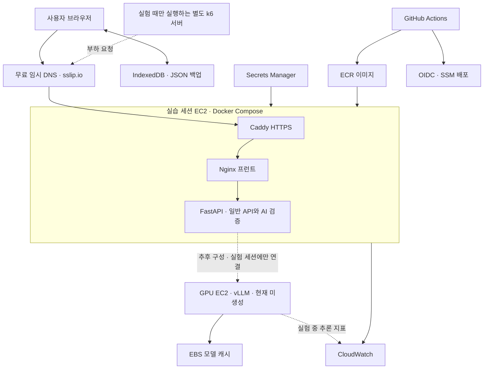

# AI Engineer 학습 사이트 서비스 아키텍처

- 작성일: 2026-10-18
- 상태: 로컬 구현·검증 완료. 2026-10-25 서울 t3.micro·ECR·SSM·OIDC 역할 생성 완료, 첫 GitHub 배포 진행 중. 실제 검증 결과는 배포 실행 기록 참조
- 목표: 읽기 → 퀴즈 → 오답 복습으로 이어지는 개인 학습 사이트를 만들고, AI 기능을 대상으로 성능 개선 실험을 진행한다.
- 현재 목표: 웹 배포 기반을 준비하고 인프라 실험 ④ 지연·비용, ⑤ 부하·장애 복구를 우선 진행한다. AI 품질 평가는 후속 범위로 관리한다.

## 0. 현재 배포 결정 — 2026-10-25 갱신

사용자는 비용을 낮추기 위해 **웹도 실습할 때만 실행, 월 $10 운영예산(세금 별도), 도메인 구매 없이 임시 HTTPS 주소**로 결정했다. 이전 웹 상시·t3.small·유료 도메인 안을 대체한다. [배포·견적·실행 결과](ai-study-site/deploy/README.md)를 현재 기준으로 사용한다.

- 공개 저장소: [CLM-BONNY/orot-ai](https://github.com/CLM-BONNY/orot-ai)
- 웹: 서울 `ap-northeast-2`의 `t3.micro` 1대, 20GB 암호화 gp3, 고정 IPv4 `13.124.182.186`. Caddy·Nginx·FastAPI를 Docker Compose로 실행한다.
- 주소: `https://orot.13.124.182.186.sslip.io`. 도메인 등록·Route 53 hosted zone을 구매하지 않는다.
- 실행: 매 부팅 후 120분 자동 정지. 실습이 끝나면 수동으로 더 일찍 정지한다. 정지 중 웹은 접속되지 않으며 EBS·고정 IP 비용은 남는다.
- 예산: 월 40시간 실행 예시의 서버·20GB 디스크·고정 IP 소계 $5.99. 월 $10은 사용자가 승인한 운영예산이며 자동 결제 차단 상한이 아니다. ECR·로그·Secrets Manager·트래픽·세금은 별도다.
- 생성 범위: 웹·네트워크·ECR·사이트 로그인 비밀·CloudWatch 로그·GitHub OIDC/SSM. GPU EC2·모델 캐시 EBS·부하 발생기는 생성하지 않는다.
- 웹 기본값 `INFERENCE_PROVIDER=disabled`: AI 요청은 모델 접속 없이 `503 MODEL_DISABLED`를 반환한다. 기본 학습·퀴즈·메모·기존 복습은 웹 실행 중 사용 가능하다.
- CI/CD: GitHub Actions 테스트/이미지 빌드 → ECR 불변 digest → OIDC/SSM → 지정 EC2 교체·검증·롤백. SSH와 장기 AWS 키를 사용하지 않는다.
- 정밀 측정은 현재 사양을 고정해 시작하고, T3 크레딧 상태를 기록한다. 추가 비용이 필요한 m7i.large·부하 발생기는 실험 조건과 비용을 정한 후 구성한다.
- 추후 GPU는 할당량·모델·vLLM 호환성을 확인한 뒤 별도 구성하고 실험 중에만 실행한다. 현재 GPU 한도 0 vCPU이며 증액도 제출하지 않았다.
- S3·CloudFront/Lambda·ECS·ALB는 초기 배포 경로에서 제외한다. 이후 병목에 근거한 개선 실험 후보로 남긴다.

## 1. 서비스 범위

1. AI Engineer가 알아야 할 AI·머신러닝·딥러닝·NLP·LLM·RAG 관련 전체 커리큘럼 구성
2. 비슷한 개념을 트랙·챕터로 묶는 학습 구조
3. 예시와 비유를 활용한 긴 설명 글
4. 개념 단위로 페이지를 넘기는 읽기 화면
5. 챕터별 기본 퀴즈와 채점·정답·해설
6. 개념 메모장, 오답노트, 오답 재풀기, 별표 문제 모아보기
7. 현재 학습 내용을 바탕으로 돕는 AI 공부 도우미
8. 선택한 주제와 틀린 개념에 기반한 AI 복습 퀴즈

기본 학습 문제는 검토된 고정 콘텐츠로 관리한다. AI 생성 문제는 기본 문제와 구분하고 오류 신고 기능을 제공한다.

## 2. 주요 설계 결정

- 읽기·퀴즈·메모·AI 도우미·새 복습 문제를 한 서비스에서 제공한다.
- 프런트는 React 정적 빌드를 Nginx 이미지에 포함하고, FastAPI는 별도 이미지로 만든다.
- 일반 API와 AI 프롬프트/출력 검증은 같은 FastAPI 코드에 둔다. 실제 모델 추론은 별도 Ollama/vLLM 서버가 담당한다.
- 로컬은 이미 받은 `qwen3.5:9b-q4_K_M`로 검증했다. 외부 OpenAI 유료 API와 API 키는 쓰지 않는다.
- 배포 모델은 GPU 실행 환경에서 다운로드한다. 모델·GPU·양자화·런타임 버전은 실제 호환성/품질 확인 뒤 확정한다.
- 개인 기록은 IndexedDB에 저장하고 JSON 백업·가져오기로 주소를 옮긴다. 첫 버전은 계정 동기화가 없다.
- 콘텐츠는 Markdown·JSON이며 프런트와 서버가 동일한 릴리스 ID를 사용한다.
- 첫 클라우드 배포는 EC2 Compose다. 웹은 실습 때만 실행하고 매 부팅 120분 뒤 정지한다. GPU는 추후 별도 실험 세션에서만 실행한다. GPU를 꺼도 글·기본 퀴즈·저장 기록은 사용할 수 있다.
- 단일 서버의 Compose 교체 배포 중 짧은 중단을 허용하고 이전 릴리스 롤백을 준비한다. 고가용성·무중단을 달성했다고 기록하지 않는다.
- Git은 소스·설정, ECR은 이미지, GPU EBS는 모델 캐시를 보관한다. 비밀 값은 Secrets Manager와 제한된 mount로 전달한다.
- 최초 기준선은 API 프로세스 1개다. 현재 동시 AI 처리 제한과 성공 요청 캐시는 프로세스 메모리이므로 다중 서버로 늘릴 때 공유 정책을 별도 설계한다.

## 3. 기술 스택

| 영역 | 기술 | 역할 |
|---|---|---|
| 프런트 | React·TypeScript·Vite | 읽기·퀴즈·복습 UI와 정적 빌드 |
| UI·콘텐츠 | 커스텀 CSS·react-markdown·KaTeX | 읽기 화면·설명·코드·수식 |
| 화면 이동·저장 | React Router·Dexie/IndexedDB | 직접 URL·브라우저별 학습 기록·백업 |
| 일반/AI API | Python·FastAPI·Pydantic·httpx | 콘텐츠 조회·입력/출력 검증·추론 호출 |
| 로컬 추론 | Ollama·기존 Qwen3.5 9B Q4_K_M | 로컬 기능 검증 |
| 배포 추론 | GPU EC2·vLLM 컨테이너 | 선택한 체크포인트 직접 실행 |
| 패키징 | Docker·Compose | 프런트/API/추론 이미지 및 실행 구성 |
| 웹 배포 | EC2·Caddy·Nginx | 실습 세션 접속·임시 HTTPS·역방향 프록시 |
| 이미지·비밀 | ECR·Secrets Manager | 불변 이미지 digest·서버 비밀 |
| 자동 배포 | GitHub Actions·AWS OIDC·SSM | 테스트·게시·키 없는 원격 배포·롤백 |
| 인프라 | CloudFormation | ECR·네트워크·EC2·IAM·로그·DNS 정의 |
| 관측·실험 | CloudWatch·k6·고정 AI 평가 세트 | 지연·부하·실패·품질·비용 비교 |

Python/Node/Nginx/Caddy 베이스와 Actions는 확인한 digest/commit을 고정한다. 배포 체크포인트와 vLLM digest는 모델/GPU 선택 후 고정한다.

## 4. 전체 아키텍처



- 기본 학습: 도메인 HTTPS → Caddy → Nginx. 학습자료는 `/content` 프록시를 거쳐 API에서 같은 릴리스를 제공한다.
- 개인 기록: 브라우저 IndexedDB에 저장하며 도메인 변경 전후 JSON 백업으로 이동한다.
- AI 기능: 브라우저 → 같은 HTTPS 주소 → API → GPU 사설 추론 주소 → 검증 결과 반환.
- 로컬 개발: Vite 프록시 → FastAPI → 기존 Ollama. 운영 빌드와 Docker 검증 경로는 별도다.
- GPU 미구성·정지 중 새 AI 생성은 사용할 수 없다. 기본 학습과 저장된 AI 복습 문제는 독립적으로 동작한다. 웹 배포와 접속 자체가 GPU를 시작시키지는 않는다.

## 5. 프런트엔드 설계

### 화면 구성

| 공간 | 주요 기능 |
| --- | --- |
| 학습하기 | 전체 목차, 페이지별 읽기, 이전·다음, 진행률, 이어 읽기, 챕터 퀴즈 |
| 복습하기 | 오답 재풀기, 별표 문제, 주제별 AI 복습 퀴즈 |
| 내 노트 | 개념별 메모 작성·검색, 관련 글과 문제로 이동 |
| 공부 도우미 | 학습 화면 옆 대화 패널, 현재 페이지·선택 문장 질문 |

### 읽기 화면

```text
┌────────────┬──────────────────────────┬──────────────┐
│            │ 챕터 / 현재 페이지       │              │
│ 전체 목차  │                          │ 공부 도우미  │
│            │ 제목                     │              │
│ 학습 진행  │ 설명·비유·예시·코드·수식 │ 질문 입력    │
│            │                          │              │
│            │ 메모하기 / 핵심 정리     │              │
│            │ 이전       3 / 8    다음 │              │
└────────────┴──────────────────────────┴──────────────┘
```

- 글은 화면 높이로 임의 분할하지 않고 개념 단위로 나눈다.
- 모바일에서는 목차와 공부 도우미를 필요할 때 여는 패널로 제공한다.
- 콘텐츠를 페이지·챕터별로 나누어 필요한 시점에 불러온다.
- 개별 학습 페이지 주소로 직접 접속하거나 새로고침해도 정상적으로 열린다.

### 실행 위치

| 브라우저에서 처리 | 서버에서 처리 |
| --- | --- |
| 페이지 이동, 기본 문제 채점, 메모, 오답·별표·진행률 | 공부 도우미 답변, AI 복습 퀴즈 생성 |

기본 학습 기능은 AI 응답과 독립적으로 사용할 수 있게 한다.

## 6. 콘텐츠 및 데이터 설계

### 콘텐츠 계층

```text
트랙 → 챕터 → 학습 페이지 → 관련 개념·문제

예: 머신러닝
     └─ 모델의 일반화
         ├─ 학습 성능과 실제 성능은 왜 다를까?
         ├─ 과적합과 과소적합
         ├─ 학습·검증·테스트 데이터
         └─ 개념 확인 퀴즈
```

각 페이지·개념·문제에 고유 ID를 부여한다. 메모·오답·별표·AI 문맥은 이 ID로 연결한다.

### 데이터 종류

| 데이터 | 주요 필드 |
| --- | --- |
| 학습 페이지 | 페이지 ID, 챕터 ID, 개념 ID, 본문, 콘텐츠 버전 |
| 기본 문제 | 문제 ID, 개념 ID, 보기, 정답, 해설, 관련 페이지, 문제 버전 |
| 풀이 기록 | 문제 ID·버전, 선택한 답, 정오 여부, 풀이 시각 |
| 메모 | 관련 페이지·개념 ID, 본문, 수정 시각 |
| 별표 | 문제 ID 또는 저장된 생성 문제 참조 |
| 학습 진행 | 읽은 페이지, 마지막 위치, 완료한 챕터 |
| AI 생성 문제 | 생성 ID, 문제·보기·정답·해설 전체, 근거 페이지 ID, 생성 설정·버전 |

### 저장 정책

- 학습 글과 기본 문제: 저장소의 Markdown·JSON 원본으로 관리한다.
- 프런트와 서버: 같은 콘텐츠 원본을 빌드에 포함하고 버전을 확인한다.
- 개인 기록: Dexie를 통해 IndexedDB에 저장한다.
- 개인 기록의 JSON 내보내기·가져오기를 제공한다.
- AI 문제는 별표·오답 재풀기가 가능하도록 생성 결과 전체를 보관한다.
- 기본 문제가 수정되어도 과거 기록을 해석할 수 있도록 풀이 당시 버전과 필요한 문제 정보를 보존한다.

첫 버전은 브라우저·기기별 저장이다. 브라우저 데이터를 삭제하면 기록이 사라질 수 있으며, 기기 간 자동 동기화는 제공하지 않는다.

향후 계정·동기화를 추가할 때 저장소 구현을 바꿀 수 있도록 화면과 저장 로직을 분리한다. 서버 DB와 로그인 기술은 그 확장 시점에 결정한다.

## 7. 일반 백엔드 설계

### 처리 단계

```text
요청 검증 → 필요한 학습자료 조회 → AI 처리 → 결과 검증 → 응답·로그 기록
```

| API | 역할 |
| --- | --- |
| GET /api/health | 배포 상태 확인 |
| GET /api/meta | API·콘텐츠 버전 확인 |
| POST /api/ai/tutor | 학습 내용 관련 질문 답변 |
| POST /api/ai/review-quiz | 선택한 개념의 복습 문제 생성 |

- 브라우저는 페이지·개념 ID를 전달하고, 서버는 배포된 콘텐츠에서 관련 자료를 찾는다.
- 선택 문장과 사용자 질문은 별도 사용자 입력으로 다루고 길이·형식을 검증한다.
- 프런트와 서버의 콘텐츠 버전 불일치를 확인할 수 있게 한다.
- 오류 응답에는 사용자용 안내와 요청 ID를 포함한다.

### 오류 분류

- 입력 오류
- 존재하지 않는 학습자료
- 요청 제한
- AI 응답 시간 초과
- 모델 제공자 오류
- 생성 결과 검증 실패

화면에는 이해할 수 있는 안내와 다시 시도 버튼을 제공하고, 상세 원인은 로그에서 확인한다.

## 8. AI 백엔드 설계

### 공부 도우미

- 입력: 현재 페이지 ID, 선택 문장, 질문, 길이가 제한된 최근 대화
- 문맥: 서버가 현재 페이지와 연결된 개념 자료를 조회해 구성
- 출력: 설명, 예시, 관련 학습 페이지
- 빠른 질문: 다른 비유로 설명, 예시 추가, 힌트 요청

처음에는 개념 ID와 연결 정보를 이용해 자료를 조회한다. 전체 문서 대상 의미 검색이 필요해질 때 임베딩·벡터 검색을 추가한다.

### AI 복습 퀴즈

- 입력: 선택 개념 ID, 틀린 개념 목록, 난이도
- 출력: 새 문제 3개, 보기, 정답, 해설, 근거 페이지 ID
- 오답 재풀기는 기존 문제를 다시 푸는 기능이고, AI 복습 퀴즈는 같은 개념의 새 문제를 생성하는 기능이다.

### 생성 결과 검증

- 모델 서버의 JSON Schema 출력 제약과 Python 검증을 함께 사용한다. 공부 도우미와 복습 문제 생성에 적용한다.
- 서버에서 문제 수·보기 수·정답 번호·중복·필수 해설을 검사한다.
- 근거 페이지 ID가 실제 콘텐츠에 존재하는지 확인한다.
- 생성 후 같은 로컬 모델에 별도 검토 프롬프트를 보내 정답·해설·주제·근거를 대조한다. 한 문제라도 통과하지 못하면 세트 전체를 반환하지 않는다.
- 생성과 검토 두 호출이 하나의 전체 시간 제한을 공유하며, 두 호출의 시간·토큰과 검토 프롬프트 버전을 기록한다.
- 스키마 준수는 정답 정확성을 보장하지 않으므로 별도 내용 평가와 오류 신고가 필요하다.
- 모델의 자동 검토도 오류가 있을 수 있다. 생성 문제는 사람 검토 전 `unreviewed`로 보관한다.

### 모델·프롬프트 관리

- 모델명은 설정으로 관리한다.
- 현재는 기존 Qwen 모델을 사용한다. 큰 모델은 실행 가능한 하드웨어·가중치 형식·사용 조건을 확인하고 한국어 설명·문제 품질·시간·비용을 비교한다.
- 기준선 측정 시 모델·프롬프트·콘텐츠 버전을 기록한다.
- 요청별 입력·출력 토큰과 재시도 횟수를 기록한다.

## 9. 배포 설계

[상세 파일·절차·가격 근거](ai-study-site/deploy/README.md)를 따른다. 서울 t3.micro·ECR·OIDC·SSM이 생성됐으며 실제 배포와 검증 결과는 실행 기록에서 확인한다. 도메인 구매와 GPU 구성은 현재 범위에서 제외했다.

### 패키징과 자동 배포

1. GitHub main/PR에서 자동 테스트·TypeScript·운영 빌드·인프라 lint를 실행한다.
2. 실제 Docker web/API 컨테이너를 띄워 프록시·전체 콘텐츠·직접 URL·오류·사이트 인증을 검사한다.
3. AWS 준비 후 OIDC로 제한된 Role을 사용해 이미지를 ECR에 게시한다. SHA 기반 태그와 불변 digest를 기록한다.
4. SSM으로 지정 CPU EC2만 업데이트한다. SSH 키와 장기 AWS 키를 GitHub에 넣지 않는다.
5. Docker Compose 교체 후 내부 health와 공개 HTTPS의 코드 개정을 확인한다. 실패하면 이전 릴리스로 복구한다.
6. 웹 배포 워크플로는 GPU를 생성·시작하지 않는다. GPU 이미지 게시·인프라 구성·모델 검증·실험 세션 시작은 각각 별도 단계다. 가중치는 Git/앱 이미지에 넣지 않는다.

### 도메인·보안·운영

- Caddy로 HTTPS 발급/갱신, 공인 주소는 CPU EC2에 고정한다.
- 최초 사이트는 비밀번호로 보호하고 AI 요청량을 제한한다. GPU 포트는 API 서버와 별도로 허용한 내부 부하 발생기에서만 접근한다.
- 모델 인증과 사이트 로그인은 Secrets Manager에서 읽어 해당 컨테이너의 파일로 전달한다. 비밀 값은 Git·빌드 인자·SSM 명령 본문·로그에 넣지 않는다.
- 웹은 실습 때만 운영하며 매 부팅 120분 후 systemd timer로 정지한다. 월 누적 실행 시간은 자동 차단하지 않는다. GPU는 모델·실험 조건 확정 후 구성하고 실험할 때 명시적으로 시작한다. 세션 종료 예약과 실제 stopped 상태를 확인한다. 초기 모델 다운로드·검증 시간도 실행 시간에 포함한다.
- 현재 GPU 세션 스크립트는 기본 60분, 허용 범위 15~180분이며 종료 예약 실패 시 정지하도록 준비되어 있다. 실제 AWS 실행 검증은 아직 하지 않았다. 월 10시간은 견적 예시이며 자동 누적 시간 차단이나 상시 실행 계획이 아니다.
- 기본 웹 서버는 `t3.micro`이며 T3에만 standard CPU 크레딧 설정을 적용한다. 정밀 측정용 `m7i.large`에는 CPU 크레딧 속성을 지정하지 않는다. GPU·캐시 크기는 체크포인트에 맞춘다.
- 앱의 AI 전체 마감 180초, Nginx 190초, Caddy 응답 헤더 대기 200초로 구성한다. 이 경로는 API Gateway HTTP API를 사용하지 않는다.
- 활성 인프라는 `deploy/cloudformation`이다. `alternatives/ecs`는 실행하지 않는 대안 자료다.

### 배포 완료 기준

| 단계 | 완료 기준 |
|---|---|
| 현재 웹 배포 | 임시 HTTPS에서 읽기·기본 퀴즈·메모·저장된 복습이 동작하고 GPU 미구성 중 AI 요청 실패가 처리됨. main → CI → ECR → EC2 배포, 코드 버전 확인·재시작·이전 릴리스 롤백 검증 |
| 추후 AI 실험 환경 | 모델/GPU/이미지/문맥 길이를 확정하고 사설 추론 연결·실제 AI 생성·세션 종료 예약·stopped 상태를 검증 |
| 인프라 실험 | 배포 버전과 조건을 고정해 ④ 지연·비용, ⑤ 부하·장애 복구의 기준선과 전후 비교를 기록 |

웹 배포 완료와 AI 실험 환경 완료를 구분한다. 파일 작성·CI 녹색 표시만으로 AWS 배포를 완료했다고 기록하지 않는다.

## 10. 관측과 성능 실험

### 공통 로그

- 요청 ID, API 종류
- 코드·모델·프롬프트·콘텐츠 버전
- 전체 API 처리 시간, 모델 호출 시간
- 입력·출력 토큰
- 성공 여부, 오류 종류, 재시도 횟수
- 모델 준비·콜드/웜 상태, CPU·메모리·GPU 사용량, T3 CPU 크레딧 상태

질문·메모·대화 본문 전체를 성능 로그에 무조건 남기지 않는다. 비교에 필요한 식별자와 수치 중심으로 기록한다.

### 스터디 연계

| 주차 | 실험 대상 | 주요 결과 |
| --- | --- | --- |
| 테스트 전 | 웹 배포·HTTPS·CI/CD·로그·지표 수집, GPU는 미생성 | 웹 배포 기록과 재현 절차 |
| 4주차 | 고정 환경에서 기준선 측정. 추론 실험에 앞서 GPU 환경 별도 준비 | p50·p95, 처리량·오류율·자원·비용 |
| 5주차 | 웹·API와 추론을 구분한 부하·병목 분석 | 병목 근거와 설정 변경 전후 비교 |
| 6주차 | 추론 실험 세션에서 동시 처리·대기·자원 효율 비교 | 추론 처리량·응답시간·GPU 실행 시간 |
| 7주차 | API 재시작·GPU 정지·타임아웃·배포 실패와 롤백 | 영향 범위·복구시간·재현 절차 |
| 8주차 | 최초·최종 버전 통합 비교 | 최종 사이트·리포트·발표 |

- 실제 모델 호출 테스트와 모델을 고정 응답으로 대체한 테스트는 구분한다.
- HTTP 성공 외에 유효한 퀴즈 생성 여부도 측정한다.
- 고정 입력과 동일한 조건을 사용하고 한 번에 한 변수를 바꾼다.
- 적은 표본의 p95는 관찰용 참고값으로 표시한다.
- 직접 모델을 서빙하면 토큰 사용량 외에 GPU 서버 실행·유휴 시간과 자원 사용을 비용에 반영한다.
- 모델 다운로드·최초 로딩·GPU 기동 시간은 준비된 모델의 응답시간과 분리한다. GPU를 켠 실험만 AI 추론 결과로 기록한다.

## 11. 개발 순서와 완료 기준

| 순서 | 작업 | 완료 기준 |
| --- | --- | --- |
| 1 | 목차·콘텐츠·문제·기록 형식 설계 — 완료 | 모든 데이터가 ID로 연결됨. 실제 콘텐츠와 기록 예시의 스키마·연결 검증 통과 |
| 2 | 프런트·Python API 기본 구성과 로컬 Qwen 연결 — 로컬 검증 완료 | 사용자 요청으로 첫 클라우드 배포를 이후로 변경. 로컬 브라우저에서 실제 AI 답변 확인 |
| 3 | 전체 콘텐츠와 페이지형 읽기 화면 — 완료 | 8개 트랙·32개 챕터·96개 페이지 탐색, 읽기 완료·취소, 새로고침 후 기록·스크롤 복원 확인 |
| 4 | 기본 퀴즈·메모·오답·별표 — 완료 | 객관식·인출·종합 문제, 메모 수정, 오답 재풀이, 별표 복습과 새로고침 후 기록 유지 확인 |
| 5 | 공부 도우미·AI 복습 퀴즈 — 로컬 검증 완료 | 근거 링크·설명 메모 저장, 현재/오답 개념으로 3문제 생성·검토·저장·풀이·재풀이 가능 |
| 6 | 로컬 운영 빌드 완료 · 실습용 AWS 웹 배포 진행 | 임시 HTTPS·ECR·OIDC/SSM CI/CD·재시작·롤백·정지 확인. 실제 결과는 배포 실행 기록에 보관. GPU와 성능 기준선 측정은 후속 범위 |

전체 기능 구현 목표를 유지하되 실제 API 호출과 배포를 초반에 검증한다. 완료 여부는 구현 시도나 화면 존재가 아니라 실제 흐름의 성공으로 판단한다.

### 1단계 완료 결과

- [데이터 구조·ID·기록 설계서](data-design/README.md)
- [실제 콘텐츠 JSON](data-design/data/content-bundle.json): 트랙 8개·챕터 32개·페이지 96개·개념 215개·문제 102개
- [콘텐츠·개인 기록·AI 요청/응답 스키마](data-design/schema/data-contract.schema.json)
- [개인 기록 예시](data-design/examples/learning-backup.json) 및 [검증 결과](data-design/validation-report.json)
- 객관식 보기 순서 변경, 오답 재풀이, 문제 개정 후 과거 스냅샷 보존을 검증했다.
- 웹 화면·IndexedDB 저장·실제 AI 호출·배포의 완료를 의미하지 않는다.

### 2단계 로컬 통합 결과

- [구현·실행 안내](ai-study-site/README.md)
- React·TypeScript·Vite 학습 화면과 FastAPI 연결, 기존 96개 학습 페이지 표시
- 기존 Qwen3.5 9B Q4_K_M을 실제 호출하고 브라우저에 답변 표시
- 백엔드 테스트 10개 및 프런트 TypeScript·프로덕션 빌드 통과
- [실제 로컬 연결 관측값](ai-study-site/local-test-result.json): 화면 질문 한 건 약 10.4초, 입력 541·출력 157토큰. 부하 테스트나 p95 기준선은 아님
- 모델 재다운로드·OpenAI API 호출·클라우드 리소스 생성은 수행하지 않음

### 3단계 학습 리더 결과

- [전체 목차와 페이지형 읽기 화면](ai-study-site/README.md): 개념·제목 검색, 트랙 필터, 페이지 이동, 선행 챕터와 참고 자료
- IndexedDB(Dexie)에 로컬 프로필·페이지별 읽기 상태·마지막 페이지와 스크롤 위치를 저장한다.
- 읽기 완료는 직접 표시한다. 콘텐츠 개정 시 이전 버전의 기록을 유지하고 현재 버전의 진행률과 구분한다.
- 저장 테스트 10개, TypeScript·프로덕션 빌드, 96개 본문의 실제 HTTP 조회 통과
- 실제 브라우저에서 완료·취소·새로고침 후 유지·이어 읽기 위치 복원 확인. [검증 기록](ai-study-site/reading-test-result.json)
- 저장은 현재 브라우저에 한정된다. 계정 동기화·백업 UI·퀴즈·메모 화면·배포 후 모바일 검증은 아직 완료하지 않았다.

### 4단계 퀴즈와 개인 학습 기록 결과

- [나의 학습 구현·사용 안내](ai-study-site/README.md): 챕터 퀴즈·오답노트·별표한 문제·개념 메모장·풀이 이력
- 객관식 64개와 인출 연습 32개, 종합 서술형 6개를 연결했다. 객관식은 보기 ID로 채점하고, 서술형은 설명 기준과 자기평가로 별도 저장한다.
- 페이지·개념·문제 메모를 저장하고 검색·수정할 수 있다. 오답·별표 목록에서 근거 본문으로 이동할 수 있다.
- 풀이·별표는 당시 문제의 개정 버전과 전체 스냅샷을 보존한다. 재풀이 정답은 다시 풀 대상에서 제외하되 과거 오답은 보존한다.
- Dexie 버전 2가 버전 1의 프로필·읽기·이어 읽기 기록을 보존하는 테스트 통과
- 프런트 테스트 23개, TypeScript·프로덕션 빌드, 실제 HTTP 문제 파일 33개 조회 및 실제 브라우저 흐름 검증 통과. [검증 기록](ai-study-site/practice-test-result.json)
- 현재 브라우저에 저장한다. 계정 동기화·백업 UI·AI 새 문제 생성·클라우드 배포는 이 단계의 완료 범위가 아니다.

### 5단계 공부 도우미와 AI 복습 결과

- [실행·사용 안내](ai-study-site/README.md) · [검증 기록](ai-study-site/ai-test-result.json)
- 공부 도우미가 현재 페이지와 관련 자료를 참고하고 근거 링크를 제공한다. 자료로 답하기 어려우면 근거 부족 상태를 표시하며, 답변을 페이지 메모로 저장할 수 있다.
- 현재 페이지·선택 개념·오답 개념으로 복습 객관식 3개를 생성한다. 형식·중복·선택 개념·근거를 검사한 뒤 별도 모델 호출로 정답·해설을 대조한다.
- 생성과 검토가 공유하는 전체 마감 시간은 180초다. 로컬 기본 문맥 4,096토큰, 생성 최대 1,536토큰, 검토 최대 512토큰을 사용한다.
- IndexedDB 버전 3에서 생성 실행과 문제를 원자적으로 저장하고 문제 해시를 확인한다. 기존 오답·별표·메모와 연결한다.
- 백엔드 42개·프런트 33개 테스트 및 프로덕션 빌드 통과. 실제 Qwen의 생성·검토·저장·풀이, 도우미 답변·메모 저장·근거 부족 처리 확인.
- 복습 한 세트 실측 약 48.8초(생성 33.1초 + 검토 15.7초). 단일 기능 점검이며 성능 기준선이 아니다.
- [실제 생성 예시](ai-study-site/ai-review-example.json)는 `unreviewed`다. 구조 검사와 같은 모델의 검토가 정답 유일성과 교육 품질을 보장하지 않으므로 이후 품질 평가가 필요하다.
- 새 모델 다운로드·유료 외부 AI API·클라우드 리소스 생성은 수행하지 않았다.

### 6단계 로컬 완성 결과

- 사용자 결정에 따라 AWS 공개 배포는 나중에 진행한다. 클라우드 리소스나 공개 URL을 만들지 않았다.
- [로컬 실행·검증 안내](ai-study-site/local-completion.md) · [상세 점검 결과](ai-study-site/end-to-end-test-result.json)
- `python3 run_local.py --production`으로 Vite 개발 서버 없이 React 빌드·콘텐츠·FastAPI를 기존 5178 주소에서 제공한다. 직접 학습·퀴즈·복습 URL을 열고 새로고침할 수 있다.
- JSON 백업·가져오기 UI를 완성했다. 기존 계약 스키마·문제 해시·소유자·채점·생성 연결을 검증하고, 현재 기록을 유지하며 원자적으로 합친다. 충돌 시 전체 취소한다.
- 백엔드 61개·프런트 41개, 총 102개 테스트와 운영 빌드 통과. 실제 HTTP로 96개 본문·102개 문제·11개 직접 URL·없는 API/파일 오류를 확인했다.
- 기존 검증용 기록을 별도 주소로 실제 내보내기·가져오기하고 메모·풀이·별표·생성 세트 보존을 확인했다. 사용자 기본 주소의 기록은 수정하지 않았다.
- 390px 모바일 크기에서 읽기 완료·퀴즈 채점·목차·도우미·복습 세트·메모 저장 확인. 320px 읽기/퀴즈 가로 넘침 없음 확인. 실제 휴대폰·Safari 점검은 남아 있다.
- 운영 빌드에서 실제 Qwen 답변 약 19.1초와 근거 링크·메모 저장 확인. 모델 종료 시 실제 503 안내와 질문 보존 확인. 부하/성능 기준선 측정은 아직 하지 않았다.
- 현재 운영 빌드도 loopback 로컬 실행용이다. 추후 AWS 배포의 HTTPS·접근 제한·요청 제한·GPU 인프라는 별도로 구성한다.

## 12. AWS 단계별 확정할 사항

- 현재 웹 배포: 유료 리소스 비용 범위, 도메인 등록, 최소 IAM 권한, 사이트 인증, DNS·HTTPS, GPU 미구성 상태의 기본 기능 확인
- 추후 GPU 구성: 체크포인트·사용 조건·GPU 메모리·vLLM 호환성, GPU 한도, 모델 다운로드 공간·시간, 사설 통신·인증
- 실험 시작: 실행할 GPU 세션 시간, 실제 종료 예약·정지 동작, 입력·출력 길이·요청량·동시성, 비교할 고정 환경
- 공통: 코드·콘텐츠·모델 버전과 개인 기록 JSON 백업·가져오기 절차

이 문서는 현재 설계와 검증 상태를 기록한다. 클라우드 리소스 생성·실제 배포 성공은 해당 실행 기록으로 따로 확인한다.

## 13. 공식 참고 문서

- [Vite 시작하기](https://vite.dev/guide/)
- [Mangum HTTP 및 Lambda 연결](https://mangum.fastapiexpert.com/http/)
- [Dexie 문서](https://dexie.org/docs)
- [Ollama Chat API](https://docs.ollama.com/api/chat)
- [vLLM 배포](https://docs.vllm.ai/en/latest/deployment/docker/)
- [CloudFront의 S3 오리진 접근 제어](https://docs.aws.amazon.com/AmazonCloudFront/latest/DeveloperGuide/private-content-restricting-access-to-s3.html)
- [Lambda에서 Secrets Manager 사용](https://docs.aws.amazon.com/secretsmanager/latest/userguide/retrieving-secrets_lambda.html)
- [API Gateway HTTP API 제한](https://docs.aws.amazon.com/apigateway/latest/developerguide/http-api-quotas.html)
- [AWS SAM 소개](https://docs.aws.amazon.com/serverless-application-model/latest/developerguide/what-is-sam.html)
